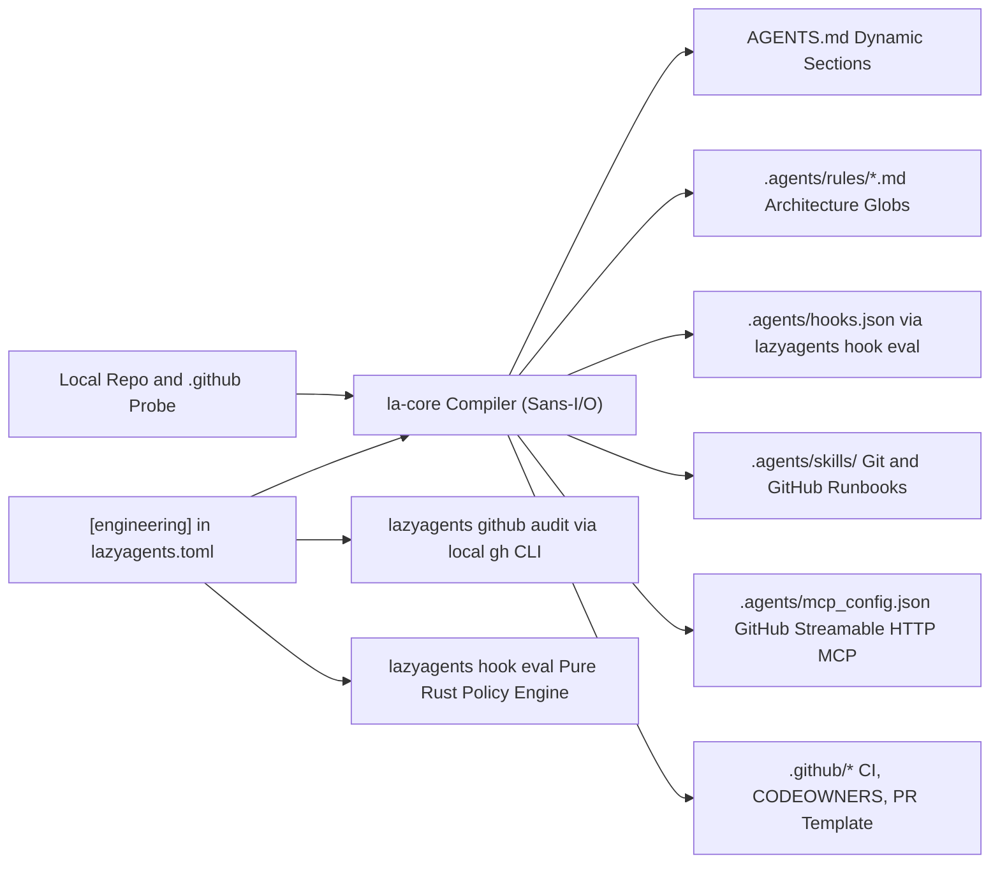
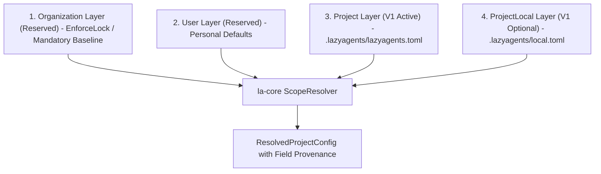

# Product Positioning & Architecture Specification (`lazyaix/lazyagents`)

This document is the authoritative product and architecture specification for **`lazyaix/lazyagents`**: a Rust-native, offline-first **Multi-Agent Project Configuration Studio, Engineering Governance Compiler, and Hook Policy Engine** delivering both an **L4 Cyber Flagship TUI** and a **CI-grade Headless CLI**.

For Rust implementation rules, see [docs/rust-standards.md](rust-standards.md). For visual/motion pipelines and terminal protocols, see [docs/tui-architecture.md](tui-architecture.md). For repository branching, Rulesets, and release governance, see [docs/git-workflow.md](git-workflow.md).

---

## 1. Product Positioning & Scope

### 1.1 Mission
AI coding agents rely on increasingly complex project-level instructions, skills, subagents, lifecycle hooks, MCP servers, and Git/GitHub guardrails. Maintaining these files by hand causes configuration drift, silent spec violations (such as context truncation or dropped skills), leaked secrets, and inconsistent engineering rules across repositories.

`lazyagents` solves this by providing:
1. **A Canonical Project Configuration Studio (TUI + CLI)** that makes authoring, inspecting, linting, and compiling project-level agent setups fast, visual, and deterministic.
2. **First-Class Google Antigravity Coverage (V1 / P0)** covering all repository-checked-in customization primitives without silent pitfalls.
3. **Engineering Governance Multi-Surface Compilation** so Git workflows, protected paths, local verification gates, supply-chain policies, architecture boundaries, and release rules are declared once and compiled consistently into agent instructions, deterministic Rust hooks, skills, and opt-in `.github/*` templates.
4. **Reserved Multi-Agent & Multi-Scope Interfaces** designed from Day 1 in `la-core` for **Claude Code**, **OpenAI Codex**, and **GitHub Copilot** targets, **User** and **Organization** scope layers, **remote Git/Registry packs**, and **optional AI-assisted drafting**.

### 1.2 V1 Coverage & Intentional Boundaries

| Dimension | V1 (P0) Active | Reserved / Post-V1 |
| :--- | :--- | :--- |
| **Target Agents** | **Google Antigravity** (8 repo-checked-in asset types) | **Claude Code**, **OpenAI Codex**, **GitHub Copilot** |
| **Configuration Scopes** | `Project` (`.lazyagents/lazyagents.toml`, Git-tracked) + `ProjectLocal` (`.lazyagents/local.toml`, gitignored) | `User` (`~/.config/lazyagents/`), `Organization` (with `EnforceLock` policy floor), machine-local `~/.gemini/projects/` |
| **Dynamic `AGENTS.md`** | 100% deterministic (`minijinja` templates + repo auto-introspection + Monorepo nested `AGENTS.md` + 24 KB / 20k token budget guardrails) | Optional AI-assisted section drafting via local Agent CLI bridge |
| **Reusable Packs** | Embedded built-in curated catalog (`lang/{rust,typescript,python,go}`, `github/*`, Git/GitHub Skills & MCP) + local directory packs | Remote `GitRepo` and `Registry` `PackSource` implementations |
| **GitHub Integration** | Opt-in `.github/*` templates & Actions security linter + read-only `gh` CLI Rulesets/settings audit + GitHub MCP & collaboration Skills | Zero remote GitHub write mutations (out of scope for V1) |
| **Hook Guardrail Runtime** | Pure built-in Rust evaluator (`lazyagents hook eval <id>`) + support for user-authored custom shell scripts | Additional `--protocol claude-code` / `codex` wire formats |
| **Interface Languages** | Built-in **English + Chinese (`en`/`zh`)** TUI & CLI localization (English default, `--lang`, locale auto-detect, in-TUI toggle) | Additional community locales |

---

## 2. Hybrid SSOT & Repository Ownership Model

`lazyagents` adopts a **Hybrid Single Source of Truth (SSOT)**: structured metadata, target wiring, dynamic `AGENTS.md` plans, hooks, MCP definitions, plugins, and `[engineering]` policies live in `.lazyagents/lazyagents.toml`, while long-form Markdown bodies and custom scripts stay in readable standalone files under `.lazyagents/`.

```text
<repo-root>/
├── .lazyagents/                      # Canonical Hybrid SSOT (committed to Git)
│   ├── lazyagents.toml               # Project manifest: targets, engineering policy, AGENTS.md, hooks, MCP, plugins
│   ├── local.toml                    # (gitignored) ProjectLocal overrides (personal MCP, local paths)
│   ├── lock.json                     # SHA-256 managed ownership lockfile (whole-file + managed-region hashes)
│   ├── sections/                     # Custom Markdown fragments for dynamic AGENTS.md
│   ├── rules/                        # Source conditional rules
│   ├── skills/                       # Source skills (<name>/SKILL.md + scripts/ + references/ + examples/)
│   ├── agents/                       # Source custom subagents
│   └── hooks/                        # Optional user-authored custom hook scripts
│
├── AGENTS.md                         # [Generated, whole-file] Root instructions (<= 24 KB verified)
├── crates/la-tui/AGENTS.md           # [Generated, optional] Monorepo subdirectory AGENTS.md
├── .agents/                          # [Generated, whole-file] Antigravity native workspace target (P0)
│   ├── rules/*.md                    # Conditional rules (including compiled architecture glob rules)
│   ├── rules.json                    # Optional declarative rule index
│   ├── skills/<name>/SKILL.md        # Validated skills (name == dir, required description) + subdirs
│   ├── skills.json                   # Declarative entries / inherits / include_only / exclude
│   ├── agents/<name>.md              # Antigravity subagent definitions
│   ├── hooks.json                    # Named hooks (built-in guardrails invoke `lazyagents hook eval <id>`)
│   ├── mcp_config.json               # Stdio + Streamable HTTP + variables (zero plaintext secrets)
│   ├── plugins/<name>/               # Cohesive plugin bundles (plugin.json + root hooks.json + ...)
│   └── plugins.json                  # Declarative plugin index
│
└── .github/                          # [Opt-in L2 Governance] Managed only when explicitly enabled
    ├── workflows/lazyagents.yml      # [Generated, whole-file] SHA-pinned, permissions: {}, zizmor-clean CI gate
    ├── CODEOWNERS                    # [Managed Block] Locks .lazyagents/, .agents/, .github/ + custom paths
    ├── pull_request_template.md      # [Generated / Managed Block] Linked verify checklist + Stacked PR + AI disclosure
    └── (opt-in preset scaffolds)     # pr-title.yml, security-zizmor.yml, dependabot.yml, ISSUE_TEMPLATE/*
```

### Git Policy & Drift Safety
- **Committed Outputs by Default (`git_mode = "commit"`)**: Generated `AGENTS.md` and `.agents/**` are committed to Git so teammates and CI immediately get active agent configurations without installing `lazyagents`, while `lazyagents check` enforces zero drift in CI. Projects may opt into `git_mode = "ignore"` to treat outputs as local build artifacts.
- **Two Ownership Modes in `.lazyagents/lock.json`**:
  1. **Whole-File Ownership** (`AGENTS.md`, `.agents/**`, `.github/workflows/lazyagents.yml`): Tracked by SHA-256. External hand edits are never silently overwritten; `generate` blocks and shows a diff (guiding the user to `import` or pass `--force`), and `check` exits with code `1`.
  2. **Managed Fenced Region Ownership** (`.github/CODEOWNERS`, `.gitignore`, partial templates): Updates strictly between `# >>> lazyagents managed start` / `# <<< lazyagents managed end` (or HTML comment markers), preserving hand-authored entries outside the fence.

---

## 3. Multi-Surface Engineering Governance & Built-in Hook Engine

`lazyagents` avoids scope creep by modeling project engineering governance once under `[engineering]` and compiling it consistently across every opted-in surface:



### 3.1 Declarative `[engineering]` Domains
1. **`[engineering.git]`**: Default branch, branching model (`trunk-based` / `github-flow` / `gitflow`), merge strategy (`squash-only` / `merge` / `rebase`), branch prefixes, Conventional Commits 1.0.0 (`pr-title` / `every-commit`), Stacked PRs (`Depends on #<pr>`), `git worktree` parallel isolation + `worktree-isolation` Skill, destructive-Git guardrails, AI-Assisted Disclosure / commit attribution / SSH signing guidance, and opt-in local Git hooks (`local_git_hooks = false` by default).
2. **`[engineering.protected_paths]`**: Declares sensitive globs (e.g., `.lazyagents/**`, `.agents/**`, `.github/**`, `deny.toml`, `SECURITY.md`) that compile simultaneously into `PreToolUse` edit/write confirmation gates (`ask` / `force_ask` / `deny`), `AGENTS.md` red lines, and `.github/CODEOWNERS` managed entries.
3. **`[engineering.verify]`**: Single source of truth for required local verification commands (`fmt`, `lint`, `test`, `doc`, `security`) compiled into `AGENTS.md`, `.github/pull_request_template.md`, and an optional Antigravity `Stop` hook.
4. **`[engineering.github]`**: Opt-in `.github/workflows/lazyagents.yml` (40-char SHA-pinned, `permissions: {}`, `merge_group`-aware, `zizmor`-clean), managed `.github/CODEOWNERS` and PR template, built-in GitHub Actions security linting (`LA014`–`LA016`), opt-in governance scaffolds (`pr-title`, `security-zizmor`, 7-day cooldown `dependabot`, `issue-templates`, `contributing`, `security-policy`), GitHub Streamable HTTP MCP preset (`variables`-only), 3 built-in collaboration Skills (`pr-author`, `ci-remediation`, `stacked-pr`), and `[engineering.github.expected_rulesets]` audited read-only via local `gh` CLI.
5. **`[engineering.supply_chain]`**: License allowlist (e.g., zero-Copyleft policy), publish cooldown days, and stateless GitHub App token (`ghs_*`) handling & redaction rules.
6. **`[engineering.architecture]`**: Module/crate dependency boundaries and core doc pointers compiled into path-scoped `glob`-triggered `.agents/rules/*.md`.
7. **`[engineering.release]`**: Release engine (`release-plz` / `changesets` / `manual`), tag pattern (`v{{ version }}`), and Immutable Releases expectations fed into `AGENTS.md`, `release-prep` Skill, and `github audit`.

### 3.2 Pure-Rust Hook Policy Evaluator (`lazyagents hook eval <id>`)
Built-in engineering guardrail hooks compile to `.agents/hooks.json` handlers calling `lazyagents hook eval <id>` instead of brittle shell scripts. This guarantees identical cross-platform behavior on macOS, Linux, and Windows with zero `jq`/`bash` dependency and full Sans-I/O testability in `la-core`:

| Guard ID | Antigravity Event | Matcher | Policy Action |
| :--- | :--- | :--- | :--- |
| `git-guard` | `PreToolUse` | `run_command` | Blocks (`deny`) direct pushes to protected branches, `--force`/`-f`, `git reset --hard`, and `git clean -fd`; gates (`ask`/`deny`) broad `git add .`/`-A` when untracked secret files are present. |
| `protected-paths` | `PreToolUse` | `edit_file\|write_file` | Intercepts edits matching `[engineering.protected_paths]` with configured `ask` / `force_ask` / `deny` decision. |
| `secret-guard` | `PreToolUse` | `write_file\|edit_file` | Scans outgoing content via `la_core::secret` (including ~520-char stateless `ghs_*` tokens) and blocks (`deny`) plaintext credential writes. |
| `verify-gate` | `Stop` | *(flat)* | When tracked files changed and `continuationActive == false`, reminds or blocks stopping until `[engineering.verify]` gates pass. |

User-authored custom scripts remain first-class via `[[hooks]] command = "./hooks/..."`.

---

## 4. Antigravity Compilation Matrix & Cross-Agent Interfaces

Target compilation in `la-core` uses an orthogonal `TargetCompiler` abstraction. In V1, **`AntigravityCompiler`** and the opt-in **`.github/*` governance compiler** are active, while **`ClaudeCodeCompiler`**, **`CodexCompiler`**, and **`GitHubCopilotCompiler`** are modeled as reserved interfaces with explicit `CompatibilityDiagnostic` reporting (never silent field drops):

| Canonical IR Primitive | Antigravity (V1 Active) | Claude Code (Reserved) | OpenAI Codex (Reserved) | GitHub Copilot (Reserved) |
| :--- | :--- | :--- | :--- | :--- |
| `InstructionDoc` | `AGENTS.md` (+ nested `*/AGENTS.md`), no frontmatter | `CLAUDE.md` (or `@AGENTS.md`) | `AGENTS.md` (shared) | `.github/copilot-instructions.md` |
| `ConditionalRule` | `.agents/rules/<id>.md` (`trigger`, expanded comma-separated `globs`, `**/...`) | `.claude/rules/<id>.md` (`paths` YAML list) | Nested `AGENTS.md` / diagnostic | `.github/instructions/<id>.instructions.md` (`applyTo`) |
| `SkillBundle` | `.agents/skills/<name>/SKILL.md` (`name == dir`, non-empty `description`) | `.claude/skills/<name>/SKILL.md` | `.agents/skills/<name>/SKILL.md` | Diagnostic |
| `SubagentSpec` | `.agents/agents/<name>.md` (`mainAgent`, `subagent`, AGY tool names) | `.claude/agents/<name>.md` (`Read`/`Edit`/`Bash`) | Profile hint / diagnostic | `.github/agents/*.agent.md` (future) |
| `LifecycleHook` | `.agents/hooks.json` (`lazyagents hook eval <id>` + custom commands) | `.claude/settings.json` (`--protocol claude-code`) | `.codex/config.toml` `[hooks]` | Diagnostic |
| `McpServerSpec` | `.agents/mcp_config.json` (Stdio / Streamable HTTP / `variables`; no legacy SSE) | `.mcp.json` (`${ENV}` expansion) | `.codex/config.toml` `[mcp_servers.*]` | `.vscode/mcp.json` (future) |
| `IndexManifest` | `.agents/{skills,rules,plugins}.json` (`entries`, `inherits`, `include_only`, `exclude`) | Diagnostic | Diagnostic | Diagnostic |
| `PluginBundle` | `.agents/plugins/<name>/` (strict `plugin.json` allowlist + root `hooks.json`) | `.claude-plugin/plugin.json` | Diagnostic | Diagnostic |

Every canonical resource supports optional per-target extension blocks (`[targets.antigravity]`, `[targets.claude_code]`, `[targets.codex]`, `[targets.github_copilot]`) so Antigravity-specific capabilities (`PreInvocation`, `overwrite`, `mainAgent`, `plugins`, `skills.json`) are exposed without loss.

---

## 5. Scope Layering Architecture



- **`ConfigScope`**: `Organization`, `User`, `Project`, `ProjectLocal`.
- **`MergePolicy`**: `Append` (deduplicated by `ResourceId`), `Override` (higher-precedence scope replaces matching fields), and `EnforceLock` (reserved for `Organization` mandatory security rules/hooks that lower scopes cannot weaken).
- **Provenance**: Every resolved item carries its winning `ConfigScope`, exposed in `lazyagents inspect` and the TUI Overview.

---

## 6. Dynamic `AGENTS.md` Engine & Compliance Linter

### 6.1 Deterministic Introspection, Rendering & Context Budgets
- **Repo Introspection (`la-runtime::prober` → `la_core::ProjectFacts`)**: Read-only offline probing of `Cargo.toml`, `rust-toolchain.toml`, `package.json`, `pnpm-workspace.yaml`, `pyproject.toml`, `go.mod`, `Makefile`/`justfile`, `.git`, `.github/workflows/*.yml`, `CODEOWNERS`, `deny.toml`, and `release-plz.toml`.
- **Template Engine (`la-core::template`)**: Uses pure-Rust, Apache-2.0 **`minijinja`** with LF normalization so `AGENTS.md` renders identically across macOS, Linux, and Windows CI runners.
- **Antigravity Context Budget Telemetry (`la-core::budget`)**: Computes exact UTF-8 bytes after expanding `@[label](path)` includes against Antigravity's **24,000-byte per-file cap**, and estimates aggregate always-on token consumption against the **20,000-token** `defaultRulesBudget`.

### 6.2 Structured Linter Catalog (`LA001`–`LA017`)
Every diagnostic carries `{ code, severity, location, message, remediation }` and is configurable via `[lint]` (`error` / `warn` / `off`):

| Code | Category | Default | Rule Summary |
| :--- | :--- | :--- | :--- |
| `LA001` | Secret Safety | `error` | Blocks plaintext secrets in tracked files (stateless `ghs_[A-Za-z0-9._-]{36,}`, GitHub PATs, provider keys, literal `Bearer` headers). |
| `LA002` | Budget | `error` | Flags any `AGENTS.md` or rule file exceeding **24,000 bytes** (including expanded `@[label](path)` includes). |
| `LA003` | Budget | `warn` | Warns above 80% and flags above **20,000 tokens** aggregate always-on rule budget. |
| `LA004` | Skills | `error` | Enforces `SKILL.md` YAML frontmatter, kebab-case `name == directory_name`, and non-empty `description`. |
| `LA005` | Rules | `error` | Validates Antigravity `trigger` enum and normalized comma-separated `globs`. |
| `LA006` | MCP | `error` | Rejects unsupported legacy HTTP+SSE endpoints on Antigravity (suggests Streamable HTTP or `mcp-remote`). |
| `LA007` | MCP | `warn` | Flags undeclared `${VAR}` placeholders lacking `variables` declarations or redundant stdio pass-through entries. |
| `LA008` | MCP | `error` | Rejects relative `cwd` in plugin MCP configs and disallowed schema fields. |
| `LA009` | Hooks | `error` | Validates `matcher` regexes, positive timeouts, script existence, and executable permissions. |
| `LA010` | Plugins | `error` | Enforces `plugin.json` field allowlist, valid relative `logo` path, and plugin-root `hooks.json` placement. |
| `LA011` | Collisions | `error` | Detects duplicate plugin/MCP names and subagent collisions with Antigravity built-ins (`self`, `browser`, `research`). |
| `LA012` | Portability | `warn` | Reports non-lossless cross-agent mappings or conflicting target overrides. |
| `LA013` | Drift | `error` | Detects divergence between deterministic compilation output, disk files, and `.lazyagents/lock.json`. |
| `LA014` | GH Actions | `error` | Ensures every `uses:` reference in `.github/workflows/*.yml` is pinned to a full 40-character commit SHA. |
| `LA015` | GH Actions | `error` | Ensures top-level `permissions: {}` and `persist-credentials: false` on `actions/checkout`. |
| `LA016` | GH Actions | `error` | Flags dangerous `pull_request_target` checkouts and untrusted `${{ github.event.* }}` shell interpolation. |
| `LA017` | Governance | `warn` | Detects `[engineering.protected_paths]` missing from `CODEOWNERS` or `verify` commands out of sync with the PR template. |

---

## 7. Headless CLI & CI/CD Contract

Running `lazyagents` with no subcommand in an interactive TTY opens the **L4 TUI Config Studio**. Non-TTY stdout, `--no-tui`, or any subcommand runs strictly headless without initializing `la-tui`.

| Command | Description | Key Flags |
| :--- | :--- | :--- |
| `lazyagents` | Launch L4 TUI Config Studio (or print help if non-TTY) | `--lang en\|zh`, `--motion full\|reduced\|none`, `--theme <id>`, `--no-splash` |
| `lazyagents init` | Detect stack & Git/GitHub metadata, bootstrap `.lazyagents/` | `--preset <id>`, `--import`, `--git-mode commit\|ignore`, `--yes` |
| `lazyagents import` | Ingest existing `AGENTS.md`, `.agents/**`, and `.github/*` hints | `--from auto\|antigravity\|claude\|codex`, `--dry-run` |
| `lazyagents generate` *(alias: `sync`)* | Compile `.lazyagents/` → target outputs & update `lock.json` | `--target antigravity\|all`, `--dry-run`, `--force`, `--include-local` |
| `lazyagents diff` | Preview unified diff between compiled output and workspace | `--target <t>`, `--exit-code` |
| `lazyagents check` | All-in-one CI gate (schema, Antigravity, Actions security, secrets, budgets, drift) | `--target <t>`, `--strict`, `--format text\|json\|github` |
| `lazyagents inspect` | Emit machine-readable facts, budgets, targets, and scope provenance | `--format text\|json` |
| `lazyagents add \| remove \| enable \| disable` | Script/agent-friendly resource management (`section\|rule\|skill\|agent\|hook\|mcp\|plugin`) | `--preset <id>`, `--local`, `--purge-files`, `--yes` |
| `lazyagents hook eval <id>` | Built-in Rust hook policy engine (reads JSON `stdin`, writes JSON `stdout`) | `--protocol antigravity` |
| `lazyagents hook test <id>` | Dry-run test built-in or custom hooks against sample payloads | `--input <file\|->`, `--command <cmd>`, `--path <file>` |
| `lazyagents github audit` | Read-only live GitHub Rulesets/settings audit via local `gh` CLI (zero stored tokens) | `--repo <owner/name>`, `--format text\|json` |

**Exit Codes**: `0` clean pass; `1` lint, secret, budget, Actions security, drift, or audit mismatch; `2` invalid CLI usage, syntax error, missing `gh` auth, or I/O failure.

---

## 8. Four-Layer Crate Mapping & Module Blueprint

`lazyagents` preserves its strict unidirectional four-layer Cargo workspace (zero `mod.rs`, strict `lib.rs` facades, ≤ 3 levels per crate, `unsafe_code = "forbid"`, permissive `deny.toml`-compliant pure-Rust crates):

| Crate | Path | Responsibility | Planned Modules |
| :--- | :--- | :--- | :--- |
| **`la-core`** | `crates/la-core` | Pure **Sans-I/O** (`M-IMPL-IO`) canonical IR, `[engineering]` model, scope merger, `minijinja` renderer, target compilers, budget & compliance linters, `hook_eval` engine, secret redaction, lock & diff planner | `id`, `secret`, `manifest`, `engineering`, `scope`, `probe`, `template`, `budget`, `lint`, `hook_eval`, `lock`, `diff`, `catalog`, `compiler`, `error` |
| **`la-runtime`** | `crates/la-runtime` | Tokio async & filesystem shell: workspace discovery, offline repo/Git/`.github` prober, importer, atomic whole-file & managed-block writer, local pack loader, read-only `gh` CLI auditor, `$VISUAL`/`$EDITOR` handoff | `workspace`, `prober`, `importer`, `writer`, `pack_loader`, `gh_audit`, `editor`, `error` |
| **`la-tui`** | `crates/la-tui` | L4 Cyber Flagship Ratatui 0.30 + `TachyonFX` Config Studio: semantic themes, `en`/`zh` i18n, terminal protocols, TEA state machine, Dashboard & Budget Radar, Engineering & GH Audit views, 8 resource views, live syntax-highlighted preview/diff, dual-mode body editor, shadowed modals, guided Init wizard | `config`, `theme`, `i18n`, `protocol`, `effects`, `state`, `action`, `views`, `editor`, `error` |
| **`lazyagents`** | `crates/la-cli` | Thin binary entrypoint (< 100 LOC `main.rs`), `clap` CLI, headless CI & `hook eval` / `github audit` runners, TUI session runner, `color-eyre` panic hook & `tracing` setup | `main`, `cli`, `commands`, `tui_runner`, `output` |

---

## 9. Phased Delivery Roadmap (Stacked Vertical PRs)

- **M0 — Positioning & Spec Alignment**: Commit `docs/architecture.md`; align `README.md`, `AGENTS.md`, `docs/tui-architecture.md`, `docs/rust-standards.md`, and crate descriptions.
- **M1 — `la-core` IR, Compilers, Hook Engine & Linters**: Manifest + `[engineering]` schema, `ScopeResolver`, `minijinja` dynamic `AGENTS.md` renderer, `AntigravityCompiler` + `.github/*` compiler + reserved Claude/Codex/Copilot interfaces, `hook_eval` policy engine, `LA001`–`LA017` linters, budget telemetry, and `lock.json`/diff planner.
- **M2 — `la-runtime` + Headless CI & Hook CLI**: Offline repo/Git/`.github` prober, importer, atomic whole-file & managed-block writer, built-in curated catalog (`lang/{rust,typescript,python,go}`, `github/*`, Git/GitHub Skills & MCP) + local pack loader, `gh` read-only auditor, and full `clap` CLI (`init`, `import`, `generate`, `diff`, `check`, `inspect`, `add/remove/enable/disable`, `hook eval/test`, `github audit`) — dogfooded on this repository.
- **M3 — `la-tui` L4 Cyber Config Studio**: Full Ratatui 0.30 + `TachyonFX` studio with Dashboard, Budget Radar, Engineering & GH Audit views, 8 resource editors, live preview/diff, interactive hook tester, `Ctrl+K` command palette, guided Init wizard, `$EDITOR` handoff, `en`/`zh` i18n, and multi-resolution `TestBackend` + `insta` snapshots.
- **M4 — Ecosystem Extensions**: Activate `ClaudeCodeCompiler`, `CodexCompiler`, and `GitHubCopilotCompiler`; enable `User` & `Organization` (`EnforceLock`) scopes; add remote Git/Registry `PackSource`; add optional local Agent CLI AI-drafting bridge.
