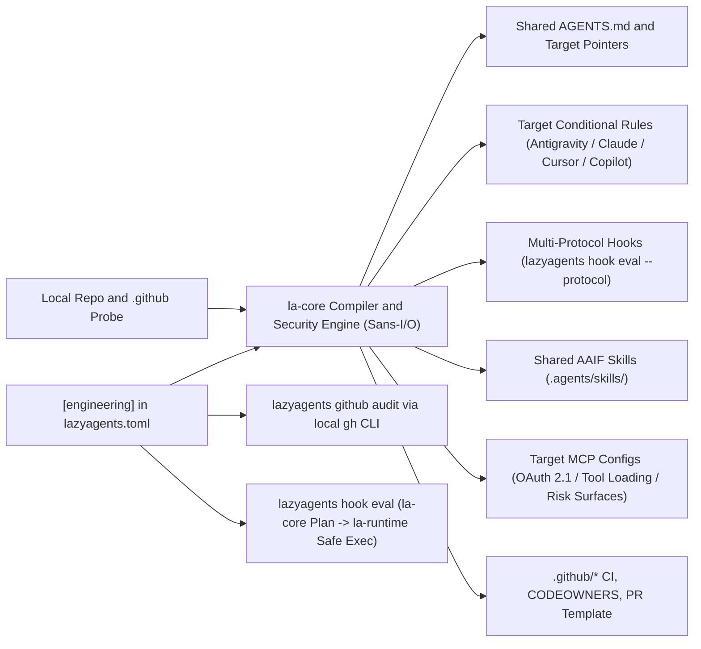
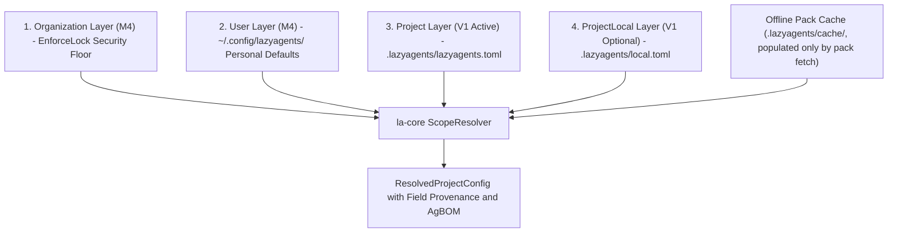

# Product Positioning & Architecture Specification (`lazyaix/lazyagents`)

This document is the authoritative product and architecture specification for **`lazyaix/lazyagents`**: a Rust-native, offline-first **Multi-Agent Project Configuration Studio, Engineering Governance Compiler, and Hook Policy Engine** delivering both an **L4 Cyber Flagship TUI** and a **CI-grade Headless CLI**.

For Rust implementation rules, see [docs/rust-standards.md](rust-standards.md). For visual/motion pipelines and terminal protocols, see [docs/tui-architecture.md](tui-architecture.md). For repository branching, Rulesets, and release governance, see [docs/git-workflow.md](git-workflow.md). For the 2026 empirical AI Agent engineering research informing the M4/M5 architecture, see [docs/research/agent-methodology-2026.md](research/agent-methodology-2026.md).

---

## 1. Product Positioning & Scope

### 1.1 Mission
AI coding agents rely on increasingly complex project-level instructions, skills, subagents, lifecycle hooks, MCP servers, and Git/GitHub guardrails. Maintaining these files by hand causes configuration drift, silent spec violations (such as context truncation or dropped skills), empirical context bloat, agentic supply-chain exposures, leaked secrets, and inconsistent engineering rules across repositories.

`lazyagents` solves this by providing:
1. **A Canonical Project Configuration Studio (TUI + CLI)** that makes authoring, inspecting, simulating (`rule test`, `hook test`), linting, and compiling project-level agent setups fast, visual, offline-first, and deterministic.
2. **AAIF-First Multi-Target Compilation** starting from complete **Google Antigravity** coverage (V1 / M0–M3 shipped) and expanding in M4/M5 across the 5 primary developer agent ecosystems — **Google Antigravity**, **Claude Code**, **OpenAI Codex**, **Cursor**, and **GitHub Copilot** (with Gemini CLI supported via shared `AGENTS.md`/`GEMINI.md` and `.agents/skills/` compatibility).
3. **Evidence-Based Context, Skill & Agentic Supply-Chain Governance** grounded in 2026 empirical research (`Evaluating AGENTS.md`, `SkillsBench`, OWASP Agentic Top 10 2026, Simon Willison's Lethal Trifecta): enforcing lean always-on context, progressive disclosure, hidden Unicode/prompt-injection scanning, Rug Pull version pinning, Lethal Trifecta risk scoring, and deterministic AgBOM export.
4. **Multi-Surface Engineering Governance & Pure-Rust Hook Control Plane** so Git workflows, protected paths, shell safety, fast post-edit formatting, local verification gates, supply-chain policies, architecture boundaries, and release rules are declared once and compiled consistently across agent instructions, cross-protocol pure-Rust hooks, skills, and opt-in `.github/*` templates.

### 1.2 Coverage Matrix (V1 Shipped vs M4/M5 Evolution)

| Dimension | V1 Baseline (M0–M3 Shipped) | M4–M5 Evolution (Active Roadmap) |
| :--- | :--- | :--- |
| **Target Agents** | **Google Antigravity** (8 repo-checked-in asset types) | **5-Target AAIF-First Matrix**: **Antigravity** + **Claude Code** + **OpenAI Codex** + **Cursor** + **GitHub Copilot** (shared `AGENTS.md` + `.agents/skills/` deduplication; Gemini CLI via shared standard compatibility) |
| **Configuration Scopes** | `Project` (`.lazyagents/lazyagents.toml`, Git-tracked) + `ProjectLocal` (`.lazyagents/local.toml`, gitignored) | Full 4-layer resolution activating `User` (`~/.config/lazyagents/`) and `Organization` (`EnforceLock` policy floor across secrets, Git/shell guards, and prompt-injection checks) |
| **Dynamic `AGENTS.md` & Context Governance** | Deterministic `minijinja` templates + repo auto-introspection + Monorepo nested `AGENTS.md` + Antigravity hard caps (`24 KB` / `20k tokens`) | **Double-Tier Budgets** (platform hard caps `Error` + empirical lean advisory ≤ `8 KB` / `2k tokens` `Warn`), **Push vs Pull Efficiency Radar**, Eager MCP context tax estimation, `SKILL.md` quality lint (`LA019`), and deterministic `rule test <path>` simulator. *(Explicitly rejects LLM auto-generated `AGENTS.md` / self-synthesized `SKILL.md` per 2026 empirical evidence.)* |
| **MCP 2026 & Agentic Security** | Stdio + Streamable HTTP (`variables`-only), legacy SSE rejection (`LA006`), plaintext secret scanning (`LA001`) | `schema_version = 1` additive fields: OAuth 2.1 PRM (`auth = "oauth"`), Tool Search / Code Mode (`tool_loading`), tool allow/deny lists, `risk_surfaces`; **OWASP ASI04** baseline (`LA020` Unicode/injection scan, `LA021` Rug Pull version pinning, `LA022` Lethal Trifecta & MCP tax, `AgBOM` export) |
| **Reusable Packs** | Embedded built-in curated catalog (`lang/{rust,typescript,python,go}`, `github/*`, Git/GitHub Skills & MCP) + local directory packs | Explicit offline-safe `lazyagents pack fetch` for 40-char SHA-pinned `PackSource::Git` cached under `.lazyagents/cache/` (`generate`/`check`/`diff` remain 100% offline, zero network) |
| **GitHub Integration** | Opt-in `.github/*` templates & Actions security linter (`LA014`–`LA016`) + read-only `gh` CLI Rulesets/settings audit + GitHub MCP & collaboration Skills | Zero remote GitHub write mutations preserved; CLI-first guidance when `gh` skills overlap eager GitHub MCP |
| **Hook Control Plane** | Pure-Rust evaluator (`lazyagents hook eval <id>`) with 4 built-in guards (`git-guard`, `protected-paths`, `secret-guard`, `verify-gate`) on `--protocol antigravity` + custom shell scripts | **8 built-in guards** (adding `shell-guard`, `compact-guard`, `session-context`, `auto-format` via `[engineering.format]`), 9 canonical lifecycle events, and multi-protocol wire adapters (`antigravity`, `claude-code`, `cursor`, `github-copilot`; explicit `LA012` degradation on `codex`) |
| **Interface Languages** | Built-in **English + Chinese (`en`/`zh`)** TUI & CLI localization (English default, `--lang`, locale auto-detect, in-TUI toggle) | Extended bilingual copy for 3D Governance Radar, multi-target preview switcher, MCP 2026 & Format forms |

---

## 2. Hybrid SSOT & Repository Ownership Model

`lazyagents` adopts a **Hybrid Single Source of Truth (SSOT)**: structured metadata, target wiring, dynamic `AGENTS.md` plans, hooks, MCP definitions, plugins, and `[engineering]` policies live in `.lazyagents/lazyagents.toml` (`schema_version = 1`, strictly backwards-compatible via optional defaults), while long-form Markdown bodies and custom scripts stay in readable standalone files under `.lazyagents/`.

```text
<repo-root>/
├── .lazyagents/                      # Canonical Hybrid SSOT (committed to Git)
│   ├── lazyagents.toml               # Project manifest: targets, engineering policy, AGENTS.md, hooks, MCP, plugins
│   ├── local.toml                    # (gitignored) ProjectLocal overrides (personal MCP, local paths)
│   ├── lock.json                     # SHA-256 managed ownership lockfile & deterministic AgBOM digest baseline
│   ├── cache/                        # (gitignored or vendored) Offline pack cache populated only by `pack fetch`
│   ├── sections/                     # Custom Markdown fragments for dynamic AGENTS.md
│   ├── rules/                        # Source conditional rules
│   ├── skills/                       # Source skills (<name>/SKILL.md + scripts/ + references/ + assets/)
│   ├── agents/                       # Source custom subagents
│   └── hooks/                        # Optional user-authored custom hook scripts
│
├── AGENTS.md                         # [Generated, shared AAIF root] Root instructions (hard cap 24 KB; lean target <= 8 KB)
├── crates/la-tui/AGENTS.md           # [Generated, optional] Monorepo subdirectory AGENTS.md
├── CLAUDE.md                         # [Generated, M4 when claude_code enabled] Lightweight `@AGENTS.md` pointer (default shared mode)
├── .agents/                          # [Generated, AAIF + Antigravity workspace target]
│   ├── rules/*.md                    # Conditional rules (including compiled architecture glob rules)
│   ├── rules.json                    # Optional declarative rule index
│   ├── skills/<name>/SKILL.md        # Shared AAIF Agent Skills (name == dir, validated description) + subdirs
│   ├── skills.json                   # Declarative entries / inherits / include_only / exclude
│   ├── agents/<name>.md              # Antigravity subagent definitions
│   ├── hooks.json                    # Named hooks (`lazyagents hook eval <id> --protocol antigravity`)
│   ├── mcp_config.json               # Stdio + Streamable HTTP (OAuth 2.1 / variables; zero plaintext secrets)
│   ├── plugins/<name>/               # Cohesive plugin bundles (plugin.json + root hooks.json + ...)
│   └── plugins.json                  # Declarative plugin index
│
├── .claude/                          # [Generated, M4 when claude_code enabled] rules/, skills/, agents/, settings.json (+ .mcp.json)
├── .cursor/                          # [Generated, M4 when cursor enabled] rules/*.mdc, hooks.json, mcp.json
├── .codex/                           # [Generated, M4 when codex enabled] config.toml ([mcp_servers.*])
│
└── .github/                          # [Opt-in L2 Governance & M4 Copilot target]
    ├── workflows/lazyagents.yml      # [Generated, whole-file] SHA-pinned, permissions: {}, zizmor-clean CI gate
    ├── CODEOWNERS                    # [Managed Block] Locks .lazyagents/, .agents/, .github/ + custom paths
    ├── pull_request_template.md      # [Generated / Managed Block] Linked verify checklist + Stacked PR + AI disclosure
    ├── instructions/*.instructions.md # [Generated, M4 when github_copilot enabled] Path-scoped Copilot rules
    ├── hooks/lazyagents.json         # [Generated, M4 when github_copilot enabled] Deterministic Copilot hooks
    └── (opt-in preset scaffolds)     # pr-title.yml, security-zizmor.yml, dependabot.yml, ISSUE_TEMPLATE/*
```

### Git Policy & Drift Safety
- **Committed Outputs by Default (`git_mode = "commit"`)**: Generated `AGENTS.md` and target outputs are committed to Git so teammates and CI immediately get active agent configurations without installing `lazyagents`, while `lazyagents check` enforces zero drift in CI. Projects may opt into `git_mode = "ignore"` to treat outputs as local build artifacts.
- **Two Ownership Modes in `.lazyagents/lock.json`**:
  1. **Whole-File Ownership** (`AGENTS.md`, `.agents/**`, `.claude/**`, `.cursor/**`, `.github/workflows/lazyagents.yml`): Tracked by SHA-256. External hand edits are never silently overwritten; `generate` blocks and shows a diff (guiding the user to `import` or pass `--force`), and `check` exits with code `1`.
  2. **Managed Fenced Region Ownership** (`.github/CODEOWNERS`, `.gitignore`, partial templates): Updates strictly between `# >>> lazyagents managed start` / `# <<< lazyagents managed end` (or HTML comment markers), preserving hand-authored entries outside the fence.

---

## 3. Multi-Surface Engineering Governance & Pure-Rust Hook Control Plane

`lazyagents` avoids scope creep by modeling project engineering governance once under `[engineering]` and compiling it consistently across every opted-in surface:



### 3.1 Declarative `[engineering]` Domains (8 Domains)
1. **`[engineering.git]`**: Default branch, branching model (`trunk-based` / `github-flow` / `gitflow`), merge strategy (`squash-only` / `merge` / `rebase`), branch prefixes, Conventional Commits 1.0.0 (`pr-title` / `every-commit`), Stacked PRs (`Depends on #<pr>`), `git worktree` parallel isolation + `worktree-isolation` Skill, destructive-Git guardrails, AI-Assisted Disclosure / commit attribution / SSH signing guidance, and opt-in local Git hooks (`local_git_hooks = false` by default).
2. **`[engineering.protected_paths]`**: Declares sensitive globs (e.g., `.lazyagents/**`, `.agents/**`, `.github/**`, `deny.toml`, `SECURITY.md`) that compile simultaneously into `PreToolUse` edit/write confirmation gates (`ask` / `force_ask` / `deny`), `AGENTS.md` red lines, and `.github/CODEOWNERS` managed entries.
3. **`[engineering.verify]`**: Single source of truth for required local verification commands (`fmt`, `lint`, `test`, `doc`, `security`) compiled into `AGENTS.md`, `.github/pull_request_template.md`, and the `Stop` verification hook.
4. **`[engineering.github]`**: Opt-in `.github/workflows/lazyagents.yml` (40-char SHA-pinned, `permissions: {}`, `merge_group`-aware, `zizmor`-clean), managed `.github/CODEOWNERS` and PR template, built-in GitHub Actions security linting (`LA014`–`LA016`), opt-in governance scaffolds (`pr-title`, `security-zizmor`, 7-day cooldown `dependabot`, `issue-templates`, `contributing`, `security-policy`), GitHub Streamable HTTP MCP preset (supporting OAuth 2.1 or `variables`), 3 built-in collaboration Skills (`pr-author`, `ci-remediation`, `stacked-pr`), and `[engineering.github.expected_rulesets]` audited read-only via local `gh` CLI.
5. **`[engineering.supply_chain]`**: License allowlist (e.g., zero-Copyleft policy), publish cooldown days, stateless GitHub App token (`ghs_*`) handling & redaction rules, and Agentic Supply Chain policy thresholds (OWASP ASI04).
6. **`[engineering.architecture]`**: Module/crate dependency boundaries and core doc pointers compiled into path-scoped `glob`-triggered conditional rules.
7. **`[engineering.release]`**: Release engine (`release-plz` / `changesets` / `manual`), tag pattern (`v{{ version }}`), and Immutable Releases expectations fed into `AGENTS.md`, `release-prep` Skill, and `github audit`.
8. **`[engineering.format]` & `[engineering.shell_guard]` *(M4/M5)*:**
   - **`[engineering.format]`**: Declares fast, single-file glob-matched formatter commands (`glob`, `cmd` argument array without shell interpolation, bounded `timeout_ms`) driving the built-in `auto-format` `PostToolUse` hook.
   - **`[engineering.shell_guard]`**: Declares deterministic non-Git shell guardrails (`block_destructive_rm`, `block_pipe_to_shell`, `block_credential_reads` for `~/.ssh`/`~/.aws`/`~/.gnupg`/`.env`, and custom `extra_deny_patterns`) driving `shell-guard`.

### 3.2 Pure-Rust Hook Control Plane (`lazyagents hook eval <id> --protocol <p>`)
Built-in engineering guardrail hooks compile to target hook configs invoking `lazyagents hook eval <id> --protocol <target>` instead of brittle `bash`/`jq` scripts. This guarantees identical cross-platform behavior on macOS, Linux, and Windows and full Sans-I/O testability in `la-core`:
- **Sans-I/O Separation**: `la-core::hook_eval` parses protocol-specific `stdin` into `NormalizedHookInput`, evaluates policy decisions, and emits either direct wire JSON/exit codes or a structured `FormatCommandPlan` (never spawning subprocesses inside `la-core`). For `auto-format`, `la-runtime::hook_exec` executes the validated argv plan safely with strict timeout enforcement and surfaces concise diagnostics only on failure.
- **Canonical Lifecycle Events (9)**: `SessionStart`, `UserPromptSubmit`, `PreInvocation`, `PreToolUse`, `PostToolUse`, `PostInvocation`, `PreCompact`, `Stop`, `SessionEnd`.
- **Supported Wire Protocols**: `antigravity` (V1 active), `claude-code` (M4 — `hookSpecificOutput` JSON & exit code `2` blocking), `cursor` (M4), `github-copilot` (M4); `codex` emits declarative approval guidance + explicit `LA012` diagnostics where runtime hooks have no native equivalent.

| Guard ID | Status | Canonical Event | Matcher | Policy Action |
| :--- | :--- | :--- | :--- | :--- |
| `git-guard` | V1 Active | `PreToolUse` | `shell` | Blocks (`deny`) direct pushes to protected branches, `--force`/`-f`, `git reset --hard`, and `git clean -fd`; gates (`ask`/`deny`) broad `git add .`/`-A` when untracked secret files are present. |
| `protected-paths` | V1 Active | `PreToolUse` | `file_write` | Intercepts edits matching `[engineering.protected_paths]` with configured `ask` / `force_ask` / `deny` decision. |
| `secret-guard` | V1 Active | `PreToolUse` | `file_write` | Scans outgoing content via `la_core::secret` (including ~520-char stateless `ghs_*` tokens) and blocks (`deny`) plaintext credential writes. |
| `verify-gate` | V1 Active | `Stop` | *(flat)* | When tracked files changed and continuation guard is inactive, reminds or blocks stopping until `[engineering.verify]` gates pass. |
| `shell-guard` | M4/M5 | `PreToolUse` | `shell` | Blocks destructive non-Git shell operations (`rm -rf /`, `rm -rf ~`, `chmod 777`), remote script pipes (`curl\|sh`, `wget\|bash`), and sensitive credential reads (`~/.ssh`, `~/.aws`, `~/.gnupg`, `.env`). |
| `compact-guard` | M4/M5 | `PreCompact` | *(flat)* | Reminds the agent before automatic compaction to persist active plans, decisions, and pending task state into workspace artifacts (`progress.md` / `plan.md`). |
| `session-context` | M4/M5 | `SessionStart` | *(flat)* | Injects a compact startup status note (current branch, protected-branch warning, dirty tracked file count) without mutating static system-prompt prefixes (preserving KV-Cache hit rates). |
| `auto-format` | M4/M5 | `PostToolUse` | `file_write` | Matches the edited path against `[engineering.format]` rules and executes the single-file formatter via `la-runtime::hook_exec` with tight timeout; silent on success, concise stderr feedback on failure. |

User-authored custom scripts remain first-class via `[[hooks]] command = "./hooks/..."`.

---

## 4. 5-Target AAIF-First Compilation Matrix & Deduplication Contract

Target compilation in `la-core` uses an orthogonal per-target compiler architecture under `crates/la-core/src/compiler/` (`antigravity.rs`, `claude_code.rs`, `codex.rs`, `cursor.rs`, `copilot.rs`, `github.rs`, `shared.rs`).

### 4.1 AAIF-First Shared Output Deduplication (`instruction_strategy = "shared"`)
Because modern coding agents (Antigravity, Codex, Cursor, GitHub Copilot) natively consume the Linux Foundation **AAIF** standards (`AGENTS.md` and `.agents/skills/`), emitting duplicated instruction bodies across targets wastes repository churn and triggers **double context injection** in tools that read both `AGENTS.md` and legacy vendor files.
- **Default (`shared`)**:
  - `AGENTS.md` (and Monorepo nested `*/AGENTS.md`) is compiled **once** and shared across Antigravity, Codex, Cursor, and Copilot.
  - `.agents/skills/<name>/SKILL.md` (with `scripts/`, `references/`, `assets/`) is compiled **once** as the shared AAIF skill directory.
  - **Claude Code** emits a lightweight `CLAUDE.md` bridge containing `@AGENTS.md` (plus any Claude-only addendum) and mirrors `.claude/skills/<name>/` where Claude's native discovery expects it.
  - **GitHub Copilot** relies on shared `AGENTS.md` + `.agents/skills/` and emits path-scoped `.github/instructions/*.instructions.md` and `.github/hooks/lazyagents.json` without duplicating root instructions into `.github/copilot-instructions.md`.
- **Opt-In (`standalone`)**: Any target may explicitly configure `instruction_strategy = "standalone"` in `[targets.<name>]` to emit a self-contained root copy when required by legacy runners.

### 4.2 Complete 5-Target Compilation Matrix

| Canonical IR Primitive | **Antigravity** *(V1 Active)* | **Claude Code** *(M4)* | **OpenAI Codex** *(M4)* | **Cursor** *(M4)* | **GitHub Copilot** *(M4)* |
| :--- | :--- | :--- | :--- | :--- | :--- |
| `InstructionDoc` | `AGENTS.md` (+ nested), no frontmatter | Lightweight `CLAUDE.md` (`@AGENTS.md`) or standalone copy | Shared `AGENTS.md` (+ nested) | Shared `AGENTS.md` (+ nested) | Shared `AGENTS.md` (or `.github/copilot-instructions.md` in `standalone`) |
| `ConditionalRule` | `.agents/rules/<id>.md` (`trigger`, expanded comma `globs`) | `.claude/rules/<id>.md` (`paths` YAML list) | Nested `AGENTS.md` or `LA012` diagnostic | `.cursor/rules/<id>.mdc` (`globs`, `alwaysApply`) | `.github/instructions/<id>.instructions.md` (`applyTo`) |
| `SkillBundle` | Shared `.agents/skills/<name>/SKILL.md` | `.claude/skills/<name>/SKILL.md` | Shared `.agents/skills/<name>/SKILL.md` | Shared `.agents/skills/<name>/SKILL.md` | Shared `.agents/skills/<name>/SKILL.md` |
| `SubagentSpec` | `.agents/agents/<name>.md` (`mainAgent`, `subagent`, AGY tools) | `.claude/agents/<name>.md` (`Read`/`Edit`/`Bash`/`Grep`/`Glob`) | Profile hint / `LA012` diagnostic | `.cursor/agents/<name>.md` or `LA012` | `.github/agents/<name>.agent.md` |
| `LifecycleHook` | `.agents/hooks.json` (`--protocol antigravity`) | `.claude/settings.json` (`--protocol claude-code`) | Approval policy hint / `LA012` diagnostic | `.cursor/hooks.json` (`--protocol cursor`) | `.github/hooks/lazyagents.json` (`--protocol github-copilot`) |
| `McpServerSpec` | `.agents/mcp_config.json` (Stdio / Streamable HTTP / OAuth / `variables`) | `.mcp.json` (`${ENV}`, `defer_loading`) | `.codex/config.toml` `[mcp_servers.*]` | `.cursor/mcp.json` | `.vscode/mcp.json` |
| `IndexManifest` | `.agents/{skills,rules,plugins}.json` | `LA012` diagnostic | `LA012` diagnostic | `LA012` diagnostic | `LA012` diagnostic |
| `PluginBundle` | `.agents/plugins/<name>/` (`plugin.json` + root `hooks.json`) | `.claude-plugin/plugin.json` | `LA012` diagnostic | Plugin manifest / `LA012` | `.github/plugin.json` / `LA012` |

Non-lossless mappings NEVER drop fields silently; every degradation emits a structured `CompatibilityDiagnostic` (`LA012`). Every canonical resource supports optional per-target extension blocks (`[targets.antigravity]`, `[targets.claude_code]`, `[targets.codex]`, `[targets.cursor]`, `[targets.github_copilot]`).

---

## 5. Four-Layer Scope Resolution & Offline-Safe Pack Caching



- **`ConfigScope`**: `Organization`, `User`, `Project`, `ProjectLocal`.
- **`MergePolicy`**: `Append` (deduplicated by `ResourceId`), `Override` (higher-precedence scope replaces matching fields), and `EnforceLock` (prevents lower scopes from weakening `lint.secrets`, `lint.github_actions_security`, `lint.prompt_injection` (`LA020`), destructive Git/shell guardrails, or zero-Copyleft supply-chain rules).
- **Provenance**: Every resolved item carries its winning `ConfigScope`, exposed in `lazyagents inspect`, `inspect --agbom`, and the TUI Overview.
- **Explicit Offline-Safe Remote Packs (`lazyagents pack fetch`)**:
  - `generate`, `check`, `diff`, `inspect`, `rule test`, and the TUI **never perform network I/O**.
  - Remote `PackSource::Git` references require a full 40-character commit SHA (`LA021`) and are materialized into `.lazyagents/cache/` solely via explicit `lazyagents pack fetch [--locked]`, recording SHA-256 digests into `lock.json`.

---

## 6. Double-Tier Context Budgets, Agentic Security & Linter Catalog (`LA001`–`LA022`)

### 6.1 Deterministic Introspection, Double-Tier Budgets & Push/Pull Telemetry
- **Repo Introspection (`la-runtime::prober` → `la_core::ProjectFacts`)**: Read-only offline probing of `Cargo.toml`, `rust-toolchain.toml`, `package.json`, `pnpm-workspace.yaml`, `pyproject.toml`, `go.mod`, `Makefile`/`justfile`, `.git`, `.github/workflows/*.yml`, `CODEOWNERS`, `deny.toml`, and `release-plz.toml`.
- **Template Engine (`la-core::template`)**: Pure-Rust, Apache-2.0 **`minijinja`** with LF normalization so outputs render identically across macOS, Linux, and Windows CI runners.
- **Double-Tier Context Budget & Push/Pull Telemetry (`la-core::budget`)**:
  1. **Platform Hard Caps (`Error`)**: Exact UTF-8 bytes after expanding `@[label](path)` includes against Antigravity's **24,000-byte per-file cap** (`LA002`) and aggregate always-on tokens against the **20,000-token** `defaultRulesBudget` (`LA003`).
  2. **Empirical Efficiency Targets (`Warn`, configurable in `[lint]`)**: Grounded in *Evaluating AGENTS.md* (`arXiv:2602.11988`) and *SkillsBench* (`arXiv:2602.12670`), flags bloated root `AGENTS.md` files (default advisory: `> 8,192 bytes` or `> 2,000 tokens`), static directory trees, and oversized `SKILL.md` bodies (`> 500 lines`).
  3. **Push vs Pull Efficiency & MCP Context Tax**: Quantifies always-on Push tokens (`AGENTS.md` + `always_on` rules) vs on-demand Pull footprint (conditional `glob` rules + `~50–100 token` per-skill discovery headers) plus estimated **Eager MCP Tool-Schema Context Tax** for servers not using `deferred` (Tool Search) or `code_mode`.

### 6.2 Structured Linter Catalog (`LA001`–`LA022`)
Every diagnostic carries `{ code, severity, location, message, remediation }` and is configurable via `[lint]` (`error` / `warn` / `off`):

| Code | Category | Default | Rule Summary |
| :--- | :--- | :--- | :--- |
| `LA001` | Secret Safety | `error` | Blocks plaintext secrets in tracked files (stateless `ghs_[A-Za-z0-9._-]{36,}`, GitHub PATs, provider keys, literal `Bearer` headers). |
| `LA002` | Hard Budget | `error` | Flags any `AGENTS.md` or rule file exceeding **24,000 bytes** (including expanded `@[label](path)` includes). |
| `LA003` | Hard Budget | `warn` | Warns above 80% and flags (`error`) above **20,000 tokens** aggregate always-on rule budget. |
| `LA004` | Skills Spec | `error` | Enforces `SKILL.md` YAML frontmatter, kebab-case `name == directory_name`, and non-empty `description`. |
| `LA005` | Rules Spec | `error` | Validates Antigravity `trigger` enum and normalized comma-separated `globs`. |
| `LA006` | MCP Spec | `error` | Rejects unsupported legacy HTTP+SSE endpoints on Antigravity (suggests Streamable HTTP or `mcp-remote`). |
| `LA007` | MCP Spec | `warn` | Flags undeclared `${VAR}` placeholders lacking `variables` declarations or redundant stdio pass-through entries (exempting `auth = "oauth"`). |
| `LA008` | MCP Spec | `error` | Rejects relative `cwd` in plugin MCP configs and disallowed schema fields. |
| `LA009` | Hooks Spec | `error` | Validates `matcher` regexes, positive timeouts, script existence, and executable permissions. |
| `LA010` | Plugins Spec | `error` | Enforces `plugin.json` field allowlist, valid relative `logo` path, and plugin-root `hooks.json` placement. |
| `LA011` | Collisions | `error` | Detects duplicate plugin/MCP names and subagent collisions with built-ins (`self`, `browser`, `research`, etc.). |
| `LA012` | Portability | `warn` | Reports non-lossless cross-agent mappings or conflicting target overrides. |
| `LA013` | Drift | `error` | Detects divergence between deterministic compilation output, disk files, and `.lazyagents/lock.json`. |
| `LA014` | GH Actions | `error` | Ensures every `uses:` reference in `.github/workflows/*.yml` is pinned to a full 40-character commit SHA. |
| `LA015` | GH Actions | `error` | Ensures top-level `permissions: {}` and `persist-credentials: false` on `actions/checkout`. |
| `LA016` | GH Actions | `error` | Flags dangerous `pull_request_target` checkouts and untrusted `${{ github.event.* }}` shell interpolation. |
| `LA017` | Governance | `warn` | Detects `[engineering.protected_paths]` missing from `CODEOWNERS` or `verify` commands out of sync with the PR template. |
| `LA018` | Context Lean *(M4)* | `warn` | Flags empirically bloated root `AGENTS.md` (`> 8 KB` / `2,000 tokens`), pasted static ASCII directory trees (`├──`/`└──`), or dynamic timestamp variables that bust KV-Cache prefixes. |
| `LA019` | Skill Quality *(M4)* | `warn` | Flags `SKILL.md` descriptions exceeding `1,024` chars, using first-person phrasing, or missing activation context (`What` + `When`), and `SKILL.md` bodies exceeding `500` lines without offloading to `references/`. |
| `LA020` | Agent Security *(M4)* | `error` | **OWASP ASI01/ASI04**: Scans `AGENTS.md`, rules, skills, subagents, and plugins for hidden zero-width/BiDi control chars (`U+202A..=U+202E`, `U+2066..=U+2069`), Unicode Tags smuggling (`U+E0000..=U+E007F`), and high-risk prompt-injection/exfiltration patterns (`curl \| sh`, `~/.ssh` exfiltration). |
| `LA021` | Supply Chain *(M4)* | `warn` | **OWASP ASI04 Anti-Rug-Pull**: Flags unpinned floating stdio MCP invocations (`npx -y <pkg>`, `uvx <pkg>` without `@x.y.z` pin) and `PackSource::Git` references lacking a 40-character commit SHA. |
| `LA022` | Risk & Tax *(M4)* | `warn` | **Lethal Trifecta & MCP Context Tax**: Flags agent/project configurations combining `UntrustedInput` + `PrivateData` + `ExternalEgress` without isolation/guardrails, and warns when `>= 4` eager MCP servers (or eager GitHub MCP alongside `gh` CLI skills) inflate startup schema context tax. |

### 6.3 Agent Bill of Materials (`AgBOM`)
`la-core::agbom` computes a deterministic, machine-readable **AgBOM** listing every active instruction, rule, skill, subagent, hook, MCP server, plugin, and pack with `{ id, kind, scope_provenance, source_origin, pinned_rev, sha256, risk_surfaces }`, exported via `lazyagents inspect --agbom --format json`.

---

## 7. Headless CLI & CI/CD Contract

Running `lazyagents` with no subcommand in an interactive TTY opens the **L4 TUI Config Studio**. Non-TTY stdout, `--no-tui`, or any subcommand runs strictly headless without initializing `la-tui`.

| Command | Description | Key Flags |
| :--- | :--- | :--- |
| `lazyagents` | Launch L4 TUI Config Studio (or print help if non-TTY) | `--lang en\|zh`, `--motion full\|reduced\|none`, `--theme <id>`, `--no-splash` |
| `lazyagents init` | Detect stack & Git/GitHub metadata, bootstrap `.lazyagents/` | `--preset <id>`, `--import`, `--git-mode commit\|ignore`, `--yes` |
| `lazyagents import` | Ingest existing `AGENTS.md`, `.agents/**`, `.claude/**`, `.cursor/**`, and `.github/*` hints | `--from auto\|antigravity\|claude\|codex\|cursor\|copilot`, `--dry-run` |
| `lazyagents generate` *(alias: `sync`)* | Compile `.lazyagents/` → enabled targets & update `lock.json` | `--target <t>\|all`, `--dry-run`, `--force`, `--include-local`, `--include-user` |
| `lazyagents diff` | Preview unified diff between compiled output and workspace | `--target <t>\|all`, `--exit-code` |
| `lazyagents check` | All-in-one offline CI gate (`LA001`–`LA022`, secrets, budgets, ASI04 security, Actions security, drift) | `--target <t>\|all`, `--strict`, `--format text\|json\|github` |
| `lazyagents inspect` | Emit machine-readable facts, Push/Pull budgets, targets, scope provenance, and AgBOM | `--agbom`, `--format text\|json` |
| `lazyagents rule test <path>` *(M4)* | Deterministically simulate which `AGENTS.md` and `glob` rules activate for `<path>` and total injected bytes/tokens | `--target <t>\|all`, `--format text\|json` |
| `lazyagents pack fetch` *(M4)* | Explicitly fetch 40-char SHA-pinned `PackSource::Git` bundles into offline cache | `--locked`, `--update` |
| `lazyagents add \| remove \| enable \| disable` | Script/agent-friendly resource management (`section\|rule\|skill\|agent\|hook\|mcp\|plugin`) | `--preset <id>`, `--local`, `--purge-files`, `--yes` |
| `lazyagents hook eval <id>` | Built-in Rust hook policy engine (reads JSON `stdin`, writes JSON `stdout` / exit code) | `--protocol antigravity\|claude-code\|cursor\|github-copilot` |
| `lazyagents hook test <id>` | Dry-run test built-in or custom hooks against sample payloads across protocols | `--protocol <p>`, `--input <file\|->`, `--command <cmd>`, `--path <file>` |
| `lazyagents github audit` | Read-only live GitHub Rulesets/settings audit via local `gh` CLI (zero stored tokens) | `--repo <owner/name>`, `--format text\|json` |

**Exit Codes**: `0` clean pass; `1` lint, secret, budget, security, drift, or audit mismatch; `2` invalid CLI usage, syntax error, missing `gh` auth, or I/O failure (for `hook eval --protocol claude-code`, exit code `2` signals deterministic hook denial per Claude Code's wire contract).

---

## 8. Four-Layer Crate Mapping & Module Blueprint

`lazyagents` preserves its strict unidirectional four-layer Cargo workspace (zero `mod.rs`, strict `lib.rs` facades, ≤ 3 levels per crate, `unsafe_code = "forbid"`, permissive `deny.toml`-compliant pure-Rust crates):

| Crate | Path | Responsibility | Modules (V1 Shipped + M4/M5 Planned) |
| :--- | :--- | :--- | :--- |
| **`la-core`** | `crates/la-core` | Pure **Sans-I/O** (`M-IMPL-IO`) canonical IR, 8-domain `[engineering]` model, 4-layer `ScopeResolver`, `minijinja` renderer, 5-target AAIF compilers, double-tier budget & Push/Pull telemetry, `LA001`–`LA022` & OWASP ASI04 security scanners, Lethal Trifecta analyzer, `AgBOM`, `rule_sim`, multi-protocol `hook_eval` + `FormatCommandPlan`, secret redaction, lock & diff planner | `id`, `secret`, `manifest`, `engineering`, `scope`, `probe`, `template`, `budget`, `lint`, `agbom` *(M4)*, `rule_sim` *(M4)*, `hook_eval`, `lock`, `diff`, `catalog`, `compiler` (`antigravity`, `claude_code`, `codex`, `cursor`, `copilot`, `github`, `shared`), `error` |
| **`la-runtime`** | `crates/la-runtime` | Tokio async & filesystem shell: 4-layer workspace/scope discovery, offline repo/Git/`.github` prober, multi-target importer, atomic whole-file & managed-block writer, local & explicit SHA-pinned `pack_loader`, safe bounded `hook_exec` for `auto-format`, read-only `gh` CLI auditor, `$VISUAL`/`$EDITOR` handoff | `workspace`, `prober`, `importer`, `writer`, `pack_loader`, `hook_exec` *(M4)*, `gh_audit`, `editor`, `config`, `handle`, `error` |
| **`la-tui`** | `crates/la-tui` | L4 Cyber Flagship Ratatui 0.30 + `TachyonFX` Config Studio: semantic themes, `en`/`zh` i18n, terminal protocols, TEA state machine, **3D Governance Radar** (Push/Pull efficiency, ASI04/Trifecta security, 5-target compatibility), Engineering (8 domains) & GH Audit views, resource editors & MCP 2026 forms, 5-target live preview/diff switcher, dual-mode body editor, shadowed modals, guided Init wizard | `config`, `theme`, `i18n`, `protocol`, `effects`, `media`, `highlight`, `text`, `form`, `state`, `action`, `status`, `views`, `editor`, `error` |
| **`lazyagents`** | `crates/la-cli` | Thin binary entrypoint (< 100 LOC `main.rs`), `clap` CLI, headless CI & `hook eval` / `rule test` / `pack fetch` / `github audit` runners, TUI session runner, `color-eyre` panic hook & `tracing` setup | `main`, `cli`, `commands`, `startup`, `prefs`, `tui_runner` |

---

## 9. Phased Delivery Roadmap (Sequential Vertical-Slice PRs)

### Completed V1 Baseline (`M0`–`M3`)
- **M0 — Positioning & Spec Alignment**: Committed core architecture, Rust, TUI, and GitHub workflow specs.
- **M1 — `la-core` IR, Antigravity Compiler, Hook Engine & Linters (`LA001`–`LA017`)**: Shipped canonical IR, `ScopeResolver`, `minijinja` renderer, `AntigravityCompiler`, `.github/*` governance compiler, 4 built-in Rust hook guards, budget telemetry, and `lock.json`/diff planner.
- **M2 — `la-runtime` + Headless CI & Hook CLI**: Shipped repo prober, importer, atomic writer, offline catalog, `gh` auditor, full CLI, and repository self-dogfooding.
- **M3 — `la-tui` L4 Cyber Config Studio**: Shipped Ratatui 0.30 + `TachyonFX` studio with Dashboard, Budget Radar, 8 resource views, modal forms, `Ctrl+K` command palette, `$EDITOR` handoff, `en`/`zh` i18n, and `TestBackend` + `insta` snapshots.

### M4–M5 Evolution Plan (8 Sequential Vertical-Slice PRs)
Grounded in [docs/research/agent-methodology-2026.md](research/agent-methodology-2026.md):
- **Slice 0 (`docs/m4-m5-architecture-spec`)**: Commit research reference and align `docs/architecture.md`, `docs/tui-architecture.md`, and `README.md` with the M4/M5 specification.
- **Slice 1 (`feat/ir-mcp-2026-and-schema`)**: Extend `la-core` canonical IR (`TargetKind::Cursor`, 9 `HookEvent` variants, `TargetOutputStrategy`, MCP 2026 OAuth/Tool Loading/Risk Surfaces, `[engineering.format]`, `[engineering.shell_guard]`) preserving 100% `schema_version = 1` backwards compatibility.
- **Slice 2 (`feat/empirical-budget-and-supply-chain-lint`)**: Implement double-tier Context Budgets, Push vs Pull & Eager MCP tax telemetry, `LA018`–`LA022` (lean context, skill quality, Unicode/injection scan, Rug Pull pinning, Lethal Trifecta), and `AgBOM` (`inspect --agbom`).
- **Slice 3 (`feat/hook-control-plane-v2`)**: Implement multi-protocol wire adapters (`claude-code`, `cursor`, `github-copilot`), `shell-guard`, `compact-guard`, `session-context`, `auto-format` (`la-core` plan + `la-runtime::hook_exec`), and expanded `hook test`.
- **Slice 4 (`feat/multi-target-compilers`)**: Activate `ClaudeCodeCompiler`, `CodexCompiler`, `CursorCompiler`, and `GitHubCopilotCompiler` with AAIF-first shared output deduplication and golden snapshot tests.
- **Slice 5 (`feat/rule-test-and-scopes`)**: Ship deterministic `lazyagents rule test <path>`, activate `User` & `Organization` (`EnforceLock`) 4-layer scopes in `la-runtime`, and implement explicit offline-safe `lazyagents pack fetch` (40-char SHA locked).
- **Slice 6 (`feat/tui-3d-governance-radar`)**: Upgrade `la-tui` Dashboard to the **3D Governance Radar**, add 5-target live preview/diff switcher and MCP 2026 / Format forms with multi-resolution `TestBackend` + `insta` snapshots.
- **Slice 7 (`chore/dogfood-v2-governance`)**: Dogfood on `lazyaix/lazyagents` — slim root `AGENTS.md` by eliminating overlap with `.agents/rules/`, enable `shell-guard`/`compact-guard`/`auto-format`, and enforce `LA018`–`LA022` in CI.
