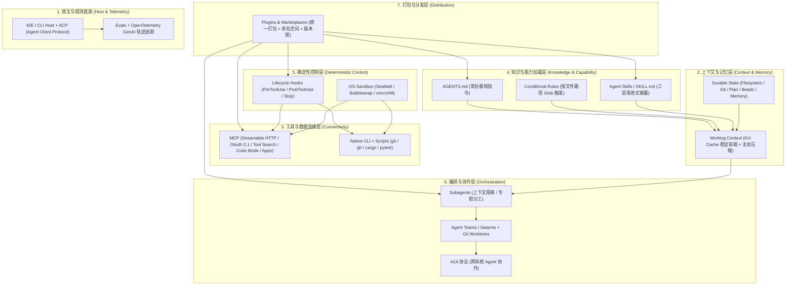
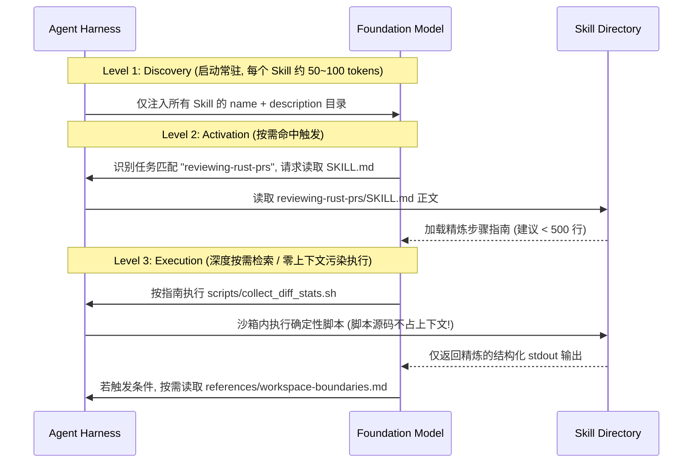
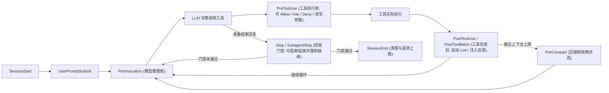
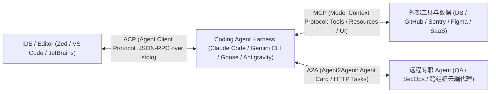
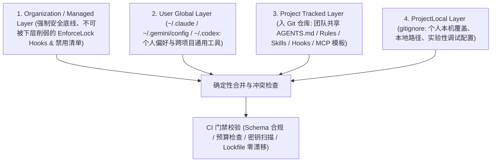

# AI Agent 使用与工程实践方法论全景调研（2026 版）

> **调研基准时间**：2026 年 11 月  
> **覆盖范围**：Harness Engineering · Context Engineering · `AGENTS.md` / Rules · Agent Skills（`SKILL.md`）· Lifecycle Hooks · MCP / ACP / A2A / CLI · Plugins & Marketplaces · Subagents & 多 Agent 编排 · 记忆系统 · 安全与沙箱 · Evals & 可观测 · 精选高信噪比信息源

---

## 执行摘要：2025–2026 的核心范式跃迁

过去两年，AI Agent 工程实践完成了从 **“如何写好一句提示词”** 到 **“如何设计一套可靠运行时系统”** 的三次范式跃迁：

1. **Prompt Engineering（2023–2024）**：关注单轮对话里怎么措辞、Few-shot 与 CoT。
2. **Context Engineering（2025）**：将大模型视作 CPU、将上下文窗口视作有限且易退化的 RAM，系统性控制**每一轮推理窗口里进什么、留什么、压什么、缓存什么**。
3. **Harness Engineering（2025–2026）**：业界达成核心共识——$\text{Agent} = \text{Model} + \text{Harness}$。当基础模型智能跨过临界点后，决定真实工程交付质量与稳定性的瓶颈往往不再是模型智商，而是围绕模型构建的**操作系统级外围框架（Harness）**：包括指令分层、按需技能、确定性钩子、工具协议、沙箱隔离、状态落盘与自动验证闭环。

> [!IMPORTANT]
> **两条经 2026 年学术实证确立的第一性原理**
>
> 1. **常驻指令（Push）越精简越好，盲目堆砌反而有害**：ETH Zurich / LogicStar.ai 在 *Evaluating AGENTS.md*（[arXiv:2602.11988](https://arxiv.org/abs/2602.11988)）中证实，LLM 自动生成的大而全 `AGENTS.md` 会让任务成功率**下降约 3%**，同时导致推理成本**飙升 20% 以上**（推理 Token 增加 14%–22%），并诱发无意义的过度探索。
> 2. **按需技能（Pull）+ 人工精炼带来跃升式收益**：UC Berkeley 等社区联合发布的 *SkillsBench*（[arXiv:2602.12670](https://arxiv.org/abs/2602.12670)）证实，高质量人工精炼的模块化 `SKILL.md`（采用渐进式披露）可将跨领域任务平均通过率从 **33.9% 提升至 50.5%（+16.6 个百分点）**；但**模型自生成技能几乎无效甚至负收益**，且 2–3 个精炼模块显著优于冗长的文档倾倒。

这两份实证研究共同锚定了现代 Agent 工程的四大设计铁律：
- **常驻极简（Minimal Push）**：`AGENTS.md` 只放非显而易见的构建/测试命令与绝对红线。
- **渐进披露（Progressive Pull）**：领域知识与长流程沉入 `SKILL.md` 与路径条件规则（Glob Rules），按需加载。
- **确定性外置（Deterministic Offload）**：安全红线、格式化、Lint、验收门禁交给 **Hooks + 本地脚本/引擎**，绝不用概率性 Prompt 赌模型听话。
- **状态落盘（Durable State）**：文件系统与 Git 历史远比长对话上下文更可靠；宁可“清空上下文 + 工件交接”，也不要让会话在 Context Rot 中腐化。

---

## 一、全景架构：现代 Agent 定制与扩展的 8 层技术栈

理解 `AGENTS.md`、Rules、Skills、Hooks、MCP、Subagents、Plugins 与 Memory 的最佳方式，是将它们放回一个清晰的分层架构模型中——每一层解决一个正交问题：



### 1.1 核心原语选型决策矩阵（When to Use What）

实践中最大的混乱来源是**原语误用**（例如把长 Runbook 塞进 `AGENTS.md`，把安全拦截写进 Prompt，把简单本地 CLI 封装成重型 MCP）。下表提供清晰的决策边界：

| 机制 / 原语 | 触发方式 | 执行确定性 | 上下文开销 | 核心职责与最佳适用场景 | 典型反模式 |
| :--- | :--- | :--- | :--- | :--- | :--- |
| **`AGENTS.md` / 根规则** | 会话启动始终加载（Push） | 概率性（软约束） | **高**（每轮都占前缀） | 仓库级非显而易见的构建/单测命令、极少数不可推知的架构边界 | 粘贴全量目录树、自动生成的样板长文、重复 Linter 规则 |
| **条件规则（Glob Rules）** | 访问匹配路径的文件时触发 | 概率性（软约束） | 低–中（局部生效） | 针对特定目录/后缀的规范（如 `crates/la-tui/**` 的 UI 约定、SQL 迁移规范） | 把全项目通用规则拆得支离破碎，或把安全底线寄托于此 |
| **Skills（`SKILL.md`）** | 元数据常驻，命中后按需加载（Pull） | 概率性指令 + 确定性脚本 | **极低**（未触发 ~100 tokens） | 跨步骤 SOP、发布/审查 Runbook、领域知识包、附带脚本与参考文档 | 把需要“每次必检”的硬约束放进 Skill；写几千行巨型单一 Skill |
| **Slash Commands** | 用户显式 `/cmd` 触发 | 人工显式触发 | 极低（调用时展开） | 高频人工启动的快捷工作流模板（如今多与可显式调用的 Skill 融合） | 需要 Agent 自主判断触发的隐性能力 |
| **Hooks（生命周期钩子）** | 事件驱动自动触发 | **100% 确定性** | **近乎为零**（仅失败时回传反馈） | 自动格式化/Lint、拦截危险命令与密钥泄露、保护敏感目录、Stop 测试门禁、审计日志 | 在 Hook 里塞进极慢的全量构建拖垮每次编辑；用复杂脆弱的正则替代 AST/专职工具 |
| **MCP Server** | 模型按需调用工具 / 读资源 | 工具执行确定，选工具概率 | 中–高（需配合 Tool Search / Code Mode） | 远程 OAuth SaaS 集成、结构化数据库/工单接口、需要 MCP Apps 交互 UI、非终端环境 | 把已有极成熟 CLI（如 `git`、`gh`）再套一层臃肿 MCP，白白吞噬数万 Schema Token |
| **Native CLI + Scripts** | Agent 通过 Shell 执行 | **100% 确定性** | **极低**（模型预训练原生熟悉） | 本地构建、测试、批处理、确定性解析/校验脚本（可封装在 Skill 的 `scripts/` 中） | 缺乏沙箱直接暴露高危凭据与无限制公网访问 |
| **Subagents / Teams** | 主 Agent 委派或并行编排 | 隔离上下文 | **节省主窗口**（只回传摘要） | 大范围只读探索、独立安全/代码审查、多模块并行实现（配合 Worktree）、大小模型分层 | 把强耦合且需共享精细推理上下文的单任务强行拆给多个互相失联的子 Agent |
| **Plugins** | 一次安装/启用整套配置 | 打包治理层 | 取决于内部组件 | 将关联的 Skills + Rules + Hooks + MCP + Subagents 打包为版本化、带命名空间的团队资产 | 零散手拷配置文件导致团队漂移、不锁版本直接引入第三方远程插件 |
| **Memory / Filesystem** | 读写持久化文件或记忆库 | 磁盘文件确定；向量记忆概率 | 按需读取 | 跨会话进度追踪（`progress.md` / `plan.md`）、任务图（Beads）、用户偏好沉淀 | 把长对话当记忆库硬撑到上下文溢出；无过期/清理机制导致记忆投毒 |

### 1.2 主流 Agent 生态配置体系横向对照（2026）

开发者通常同时使用多个 Agent（终端 Agent + AI IDE + 云端后台 Agent），理解各家的原生映射是做好跨工具治理的前提：

| 能力维度 | Claude Code | OpenAI Codex CLI | Cursor | Google Antigravity | Gemini CLI | GitHub Copilot |
| :--- | :--- | :--- | :--- | :--- | :--- | :--- |
| **根指令文件** | `CLAUDE.md`（常与 `AGENTS.md` 软链或 `@` 引用） | `AGENTS.md`（原生） | `AGENTS.md` + `.cursor/rules/` | `AGENTS.md` / `GEMINI.md`（原生层级） | `GEMINI.md` / `AGENTS.md` | `.github/copilot-instructions.md` & `AGENTS.md` |
| **路径条件规则** | `.claude/rules/*.md`（`paths` YAML） | 子目录嵌套 `AGENTS.md` | `.cursor/rules/*.mdc`（`globs`） | `.agents/rules/*.md`（`trigger` + `globs`） | 嵌套 `GEMINI.md` | `.github/instructions/*.instructions.md`（`applyTo`） |
| **Agent Skills** | `.claude/skills/<name>/SKILL.md` | `.agents/skills/<name>/SKILL.md` | `.cursor/skills/` & `.agents/skills/` | `.agents/skills/<name>/SKILL.md` + `skills.json` | `.gemini/skills/` | 通用 `SKILL.md` 目录 |
| **自定义子代理** | `.claude/agents/*.md` + Agent Teams | Profile / 多任务并行 | Background / Cloud Agents | `.agents/agents/*.md` + 内置 `research`/`browser` | 扩展/子代理模式 | `.github/agents/*.agent.md` |
| **生命周期 Hooks** | `.claude/settings.json`（~30 种事件，含 HTTP/Command/Agent Hook） | 偏声明式规则与沙箱审批策略 | 支持事件 Hooks | `.agents/hooks.json`（`SessionStart`/`PreToolUse`/`PostToolUse`/`PreInvocation`/`Stop` 等） | 原生生命周期 Hooks | Hooks for GitHub Copilot（确定性脚本） |
| **MCP 支持** | `.mcp.json`（Stdio / Streamable HTTP / Tool Search） | `.codex/config.toml` `[mcp_servers]` | 原生完整支持 | `.agents/mcp_config.json`（Stdio / Streamable HTTP / 变量声明） | 原生完整支持 | `.vscode/mcp.json` & 云端 Agent |
| **插件与分发** | `.claude-plugin/plugin.json` + Marketplaces | 插件清单支持 | Cursor Marketplace / Plugins | `.agents/plugins/<name>/plugin.json` + `plugins.json` | Gemini Extensions（`gemini-extension.json`） | `.github/plugin.json` Marketplaces |

---

## 二、指令与规则层：`AGENTS.md` 与条件规则（Rules）

### 2.1 `AGENTS.md` 开放标准与生态收敛

过去每个工具各自为政（`.cursorrules`、`CLAUDE.md`、`GEMINI.md`、`copilot-instructions.md`），造成严重的配置碎片化。2025 年底至 2026 年，由 Linux Foundation 旗下 **Agentic AI Foundation（AAIF）** 托管的 **`AGENTS.md`**（[agents.md](https://agents.md)）成为跨平台事实标准，已被数万开源项目与主流 Coding Agent 原生采纳。

其核心设计极为克制：
- **纯 Markdown、零强制 Schema**：无需专有 Frontmatter，任何模型与 Agent 运行时均可直接解析。
- **层级就近生效（Hierarchical Discovery）**：在 Monorepo 中，根目录放置全局约定，子目录（如 `packages/web/AGENTS.md`、`crates/la-tui/AGENTS.md`）放置模块特有规则。Agent 从当前工作目录向上遍历至仓库根，**更贴近当前文件的子目录指令优先级更高**，用户会话指令覆盖文件指令。
- **单源多目标（SSOT）策略**：
  - 轻量项目：以 `AGENTS.md` 为唯一真相源，对仅读 `CLAUDE.md` 的旧配置采用软链（`ln -s AGENTS.md CLAUDE.md`）或文件内 `@AGENTS.md` 引用。
  - 中大型/多工具团队：使用配置编译器从统一清单生成各平台目标文件并搭配 Lockfile（SHA-256）在 CI 中校验零漂移。

### 2.2 实证敲响的警钟：为什么大多数 `AGENTS.md` 都在拖后腿？

2026 年初，ETH Zurich 与 LogicStar.ai 的研究团队在论文 *Evaluating AGENTS.md: Are Repository-Level Context Files Helpful for Coding Agents?*（[arXiv:2602.11988](https://arxiv.org/abs/2602.11988)）中，在 SWE-bench 与真实开源仓库构建的 AGENTbench 上做了严格对照实验，结论颠覆了“越多越详细越好”的直觉：

| 维度 | 实证发现 | 工程机理剖析 |
| :--- | :--- | :--- |
| **任务成功率** | **LLM 自动生成的 `AGENTS.md` 反而使成功率下降约 3%**；人工编写的冗长文件也仅有微弱甚至无提升 | 过多的“理想主义规范”和无关背景会分散模型注意力，挤占真实解题的推理带宽 |
| **推理成本** | 引入上下文文件后，**总推理成本平均上升 > 20%**，推理 Token 增加 **14%–22%** | 每次循环都附带固定 Token 税，且指令诱发了额外步骤 |
| **行为偏移** | 模型确实会严格服从文件中的工具命令，但会触发**更宽泛、低针对性的过度探索**（过度 Grep、读无关文件、反复跑重型全量测试） | 文件中提及的模块名与全套检查流程诱导 Agent 在解决局部 Bug 时做过度审查 |
| **仓库概览无用论** | 厂商最常推荐写的“仓库目录树 / 架构全景概览”**并未帮助 Agent 更快定位目标文件** | 静态目录树迅速过时，且现代 Agent 通过 `ripgrep`/AST/文件列举动态探索的效率远高于读过时文本 |

> [!WARNING]
> **反模式警告**：不要一键运行 `/init` 让模型自动扫描仓库生成几百行 `AGENTS.md` 然后直接提交。这在实证中是最典型的“既花更多钱、又降成功率”的负优化。

### 2.3 黄金编写规范与“指令预算”管理

一条经实践检验的黄金准则：**把根 `AGENTS.md` 视作昂贵的“常驻内核内存”，尽量控制在 60–150 行（或 ≤ 4–8 KB）以内**（同时留意各宿主硬上限，如 Antigravity 的单文件 24 KB 截断线与 20k Token 常驻规则总预算）。

**✅ 应该写进根 `AGENTS.md` 的内容（高信息密度、无法靠猜得知）**：
1. **精确可复制的命令**：尤其是非默认工具链（如 `uv run pytest` 而非 `pytest`、`pnpm --filter web test`）以及**单文件/单用例精准测试命令**（避免 Agent 每次都跑 5 分钟全量套件）。
2. **反直觉的仓库边界与禁区**：例如“禁止手工修改 `src/generated/`”、“`la-core` 严禁引入 I/O 依赖”、“提交必须 Squash 且标题遵循 Conventional Commits”。
3. **指针索引（Progressive Pointers）**：用一行链接指向深度文档（如“修改数据库迁移前阅读 `docs/migrations.md`”），而非把 500 行文档全文塞进来。
4. **已知环境坑点**：特殊环境变量、必需的 Feature Flag、本地端口冲突约定。

**❌ 绝对不要写进根 `AGENTS.md` 的内容**：
- 静态全量文件树（极易过时）。
- 已被 Formatter / Linter / Typechecker 强制执行的风格细则（缩进、分号、导入排序——把这些交给 `PostToolUse` Hook 和 CI）。
- 通用软件工程废话（“写出干净、可维护、有良好测试的代码”）。
- 仅在特定任务才用的长流程 SOP（迁移到 `SKILL.md`）。
- 仅在特定目录才生效的局部规范（迁移到 **Conditional Glob Rules** 或嵌套子目录 `AGENTS.md`）。

---

## 三、能力与程序性知识层：Agent Skills（`SKILL.md`）

如果说 `AGENTS.md` 是**常驻宪法**，那么 **Skills** 就是**按需装载的专业技能模块**。

### 3.1 开放标准 `agentskills.io` 的结构解剖

最初由 Anthropic 提出、现已演进为跨平台开放标准（[agentskills.io](https://agentskills.io)），已被 Claude Code、Codex CLI、Cursor、Antigravity、Gemini CLI、GitHub Copilot、Zed 等广泛支持。一个标准 Skill 是一个自包含目录：

```text
deploy-canary/
├── SKILL.md            # 必需：YAML Frontmatter（触发元数据）+ Markdown 正文（执行 SOP）
├── scripts/            # 可选：确定性可执行脚本（Python / Bash / Node 等）
├── references/         # 可选：深度参考文档、API Schema、故障排查手册（按需读取）
└── assets/             # 可选：代码模板、样板文件、配置文件骨架
```

`SKILL.md` 的最小规范示例：

```markdown
---
name: reviewing-rust-prs
description: >-
  Reviews Rust pull requests for unsafe code, lint suppressions, error-handling
  leaks, and workspace dependency violations. Use when the user asks to review
  a PR, audit Rust changes, or verify crate boundary compliance.
compatibility: Requires git and cargo in PATH.
---

# Rust PR Review Workflow

1. Run `scripts/collect_diff_stats.sh` to inspect changed crates and lines.
2. Check boundary rules in `references/workspace-boundaries.md` only if `Cargo.toml` changed.
3. Verify zero `unsafe`, zero `#[allow(...)]`, and deterministic error types.
4. Output findings grouped by severity (Blocker / Warning / Nit).
```

### 3.2 三层渐进式披露（Progressive Disclosure）

当开发者安装了 50 个甚至 200 个技能时，把所有技能说明塞入 System Prompt 会瞬间撑爆上下文并引发注意力稀释。Skills 的核心架构创新在于 **三层渐进式披露**：



### 3.3 实证支撑：`SkillsBench` 告诉我们如何写出真正有效的 Skill

2026 年的 **SkillsBench**（[arXiv:2602.12670](https://arxiv.org/abs/2602.12670)，[skillsbench.ai](https://skillsbench.ai)）在跨 8–11 个专业领域的 87 项真实任务上系统评测了 Agent Skills，得出了四项极具指导意义的结论：

1. **显著能力跃升**：配备高质量人工精炼 Skill 后，平均通过率从 **33.9% 跃升至 50.5%（+16.6pp）**。
2. **模型自生成 Skill 失效**：让模型自己总结/自动合成 Skill 的收益趋近于零甚至为负——**真正稀缺的是人类专家沉淀的隐性领域经验与边界决策**。
3. **精炼模块化 > 大部头百科**：包含 **2–3 个聚焦模块**的 Skill 表现显著好于把所有参考资料打包倾倒的巨型 Skill。
4. **小模型的杠杆放大器**：中等/轻量模型配上优质 Skill 后，在特定专业工作流上能够追平甚至超越裸跑的旗舰大模型，具备极高的工程性价比。

### 3.4 高质量 Skill 编写四原则

1. **Description 是路由器（路由精准度决定生死）**：
   - 使用**第三人称**陈述（避免与 System Prompt 人称冲突）。
   - 同时写明 **What（做什么）** 与 **When（何时触发）**，自然埋入用户真实会说的关键词，并在必要时写明**负面边界（Don't use for...）**以防与相似 Skill 误触发冲突。
2. **自由度校准（Degrees of Freedom）**：
   - **高自由度**（代码审查、架构调研）：给目标、评估维度与原则，让模型自主推理。
   - **中自由度**（组件脚手架、PR 起草）：给推荐模板与参数说明。
   - **低自由度**（数据库迁移、发布发版、金融/安全操作）：给精确脚本与不可跳过的有序检查项。
3. **混合智能（把确定性工作下沉到 `scripts/`）**：
   - 切忌用自然语言教 LLM 做“逐行正则解析、JSON 校验、复杂数学计算、文件格式转换”。把这些写成 `scripts/` 里的 Python/Rust/Shell 工具，让 `SKILL.md` 只负责编排决策与调用脚本。
4. **评估驱动编写（Evaluation-Driven Development, EDD）**：
   - **先裸跑找痛点**：不加 Skill 先跑 3–5 个典型真实任务，记录模型究竟在哪个具体环节犯错。
   - **最小化补齐**：只针对观察到的真实失败模式写指令，不要凭空臆想写一堆模型本来就会的基础知识。
   - **迭代回归**：在有/无 Skill 两组对照上验证触发率（不漏触发、不误触发）与端到端通过率。

---

## 四、确定性控制与生命周期层：Hooks（钩子体系）

### 4.1 为什么 Hooks 是“玩具”到“工程级 Agent”的分水岭？

再强的模型本质上也是概率系统：在上下文拉长、多步推理或遭遇提示注入时，LLM 总会有 1%–5% 的概率“忘记”遵守 `AGENTS.md` 里的某条规则。

**Lifecycle Hooks** 彻底改变了游戏规则：它允许工程团队在 Agent 主循环的关键节点插入**100% 确定性的外部代码逻辑**（Shell 命令、纯原生二进制评估器、HTTP Webhook 或轻量级评审模型），实现**硬拦截、自动修复、动态注入与全链路审计**。

### 4.2 完整生命周期事件全景

现代 Agent Harness（以 Claude Code、Antigravity、Gemini CLI、GitHub Copilot 为代表）的典型事件钩子分布如下：



*(注：多 Agent 协作场景下还进一步扩展了 `TaskCreated`、`TaskCompleted`、`TeammateIdle`、`PermissionRequest` 等细粒度事件。)*

### 4.3 Hook 的四种执行形态与协议契约

1. **Command Hook（最主流）**：Harness 将事件上下文（工具名、参数、文件路径、会话 ID 等）以 JSON 传入 `stdin`；脚本处理后通过 `stdout` 返回结构化决策 JSON（如 `allow` / `deny` / `ask` + 附加反馈消息），或通过特定退出码（如 Claude Code 的 **Exit Code `2`** + `stderr` 原因）硬性阻断并将错误信息反馈给模型自纠。
2. **Native Policy Binary Hook（高可靠工程实践）**：用 Rust/Go 编译的单一无依赖二进制（例如 `lazyagents hook eval <id>`）替代脆弱的 `bash + jq` 脚本——跨 macOS/Linux/Windows 行为一致、毫秒级启动、可进行纯单元测试。
3. **HTTP / Webhook Hook**：向企业内部策略服务或审计网关发请求，适合统一安全合规中心。
4. **Prompt / Agent Hook**：在无法用纯代码判定语义的关卡（如检查产出是否偏离业务需求）时，触发一个轻量快速模型做二元门禁校验。

### 4.4 六大必落地的实战 Hook 模式

| 模式 | 挂载事件 & Matcher | 具体实现与工程价值 |
| :--- | :--- | :--- |
| **1. 高危命令与破坏性操作护栏** | `PreToolUse` (`Bash` / `run_command`) | 拦截直接推送 `main`、`git push --force`、`git reset --hard`、`rm -rf /`、无限制 `curl \| sh`，直接返回 `deny` 并提示安全替代方案 |
| **2. 密钥泄露与敏感路径保护** | `PreToolUse` (`edit_file` / `write_file`) | 扫描即将写入的文本（覆盖 API Keys、私钥、以及长达 ~520 字符的新型无状态 GitHub `ghs_*` Token）；对 `.github/workflows/**`、`infra/prod/**` 强制触发 `ask` 人工二次确认 |
| **3. 毫秒级格式化与定向 Lint 闭环** | `PostToolUse` (`edit_file` / `write_file`) | 每次写文件后自动执行极速 formatter（`ruff format`、`prettier`、`rustfmt`）与单文件 typecheck，仅在失败时把精简报错喂回给 Agent，把格式问题消灭在摇篮中 |
| **4. 确定性验收门禁（Stop Gate）** | `Stop` | 检测 `git status` 有变更时自动验证核心测试是否通过；若未通过则阻断结束并要求修复。**关键细节**：必须检查防循环标志位（如 `stop_hook_active` / `continuationActive`）或最大重试上限，避免死循环烧光额度 |
| **5. 会话冷启动上下文注入** | `SessionStart` | 自动注入当前 Git 分支、最近 5 条 commit、关联 Issue 摘要或当前激活的任务计划，省去用户每开新会话手动交代背景 |
| **6. 压缩前状态抢救** | `PreCompact` | 在上下文即将被自动压缩（Compaction）前，触发脚本或提示将当前未完成的进度、关键决策与修改文件列表落盘到 `progress.md` |

> [!TIP]
> **Hook 性能铁律**：`PreToolUse` 和 `PostToolUse` 位于 Agent 高频主循环的热路径上！单次 Hook 执行务必控制在 **< 200ms–2s** 内，严禁在每次单文件编辑的 `PostToolUse` 中跑耗时几分钟的全量集成测试（全量检查应放在 `Stop` Hook 或明确测试阶段）。

---

## 五、协议与外部连接层：MCP、ACP、A2A 与 CLI 之争

### 5.1 2026 年三大正交开放协议全景

很多初学者容易混淆 MCP、ACP 和 A2A。它们并非竞争关系，而是分别解决三个完全正交的连接维度：



- **MCP（Model Context Protocol）**：解决 **Agent ↔ 工具与数据** 的 $N \times M$ 集成难题（向下连能力），已捐赠给 Linux Foundation 下的 AAIF 托管。
- **ACP（Agent Client Protocol）**：由 Zed Industries 发起、JetBrains 等跟进，堪称 **“AI Agent 时代的 LSP”**（[agentclientprotocol.com](https://agentclientprotocol.com)）。通过标准化 JSON-RPC 协议将代码编辑器与底层 Agent 运行时解耦，任何编辑器都可以原生拉起并流式渲染任意合规 Agent 的 Diff 与审批流。
- **A2A（Agent2Agent Protocol）**：由 Google 发起并交由 Linux Foundation / AAIF 治理（[a2a-protocol.org](https://a2a-protocol.org)），通过 `Agent Card` 能力发现与异步任务协议解决**跨框架、跨网络、跨组织边界的多 Agent 互操作**。

### 5.2 MCP 2025–2026 核心架构演进（必知更新）

如果对 MCP 的认知还停留在 2024 年底的“本地 stdio + 远程 SSE + 一股脑灌入 JSON Schema”，就已经严重过时了。2025–2026 年 MCP 经历了五次脱胎换骨的工程演进：

1. **Streamable HTTP 与无状态架构（取代传统 HTTP+SSE）**：
   - 早期双通道 HTTP+SSE 在云原生负载均衡下极难维护。现代 MCP 全面迁移到 **Streamable HTTP**，且在 `2026-07-28` 核心规范更新中进一步迈向**彻底无状态（Stateless）**：移除了强制性的协议层长会话与初始化握手开销，通过标准 HTTP 路由头（`Mcp-Method`、`Mcp-Name`）即可直接放在普通无状态负载均衡器与 Serverless 网关后水平扩展。
2. **OAuth 2.1 + Protected Resource Metadata（PRM）**：
   - 远程企业级 MCP Server 标准化为 OAuth 2.1 Resource Server，通过 `401 Unauthorized` + `WWW-Authenticate` + PRM 自动发现授权服务器，彻底告别在本地配置文件里明文粘贴静态长效 API Key 的安全隐患。
3. **Tasks 扩展（长耗时异步作业）**：
   - 面对耗时数分钟的数据分析、构建或深度检索，新增 `tasks/get`、`tasks/update`、`tasks/cancel` 异步原语，避免同步阻塞整个 Agent 推理循环。
4. **MCP Apps（交互式嵌入式 UI）**：
   - Server 可通过 `ui://` URI Scheme 与 `text/html;profile=mcp-app` 返回交互式前端应用，在宿主的沙箱 `iframe` 中原生渲染可视化图表、审批表单、设计预览，并支持 UI 与 MCP Server 双向通信——突破“一切皆纯文本/JSON”的交互天花板。
5. **根治“工具定义上下文爆炸”的两大范式：Tool Search 与 Code Mode**：
   - **痛点**：接入 5 个 MCP Server（如 GitHub + Jira + Slack + Postgres + Cloudflare）往往会瞬间注入 100+ 个工具定义，直接吞掉 **30,000–80,000 Tokens**，导致首轮成本暴涨且工具选择准确率暴跌。
   - **解法 A — Tool Search（延迟加载）**：将工具标记为 `defer_loading: true`，初始仅向模型暴露一个轻量的检索工具，模型通过正则/BM25 按需拉取当前任务所需的 2–3 个工具 Schema。
   - **解法 B — Code Mode（代码执行模式）**：由 Cloudflare（[Code Mode Blog](https://blog.cloudflare.com/code-mode-the-better-way-to-use-mcp/)）与 Anthropic（[Code execution with MCP](https://www.anthropic.com/engineering/code-execution-with-mcp-building-more-efficient-agents)）大力推广。与其让 Agent 逐一进行几十轮 JSON Tool Call、把几万行中间 API 返回值灌入上下文，不如只暴露极简原语（如 `search()` + `execute()`），让模型针对类型化 SDK 编写一小段沙箱脚本一次性完成循环、过滤与聚合，仅将最终精炼结果返回给上下文——**可将复杂 API 工作流的 Token 消耗降低 90%+，同时大幅提升多步编排准确率**。

### 5.3 业界热议：MCP vs Native CLI + Skills，到底该选谁？

2025–2026 年开发者社区爆发了著名的 “MCP vs CLI” 思辨。结论并非非此即彼，而是清晰的场景分工：

| 决策维度 | 优先选 **Native CLI + `SKILL.md`** | 优先选 **MCP（+ Tool Search / Code Mode）** |
| :--- | :--- | :--- |
| **本地已有成熟 CLI** | 强烈优先（`git`, `gh`, `cargo`, `kubectl`, `aws`, `psql`）——零 Schema 税、模型预训练极其熟悉、天然支持管道组合 | 仅当需要跨宿主统一鉴权网关或屏蔽底层 Shell 权限时 |
| **远程 SaaS 与企业 OAuth** | 本地管理多套凭据痛苦且不安全 | **强烈优先**（标准 OAuth 2.1 流、细粒度 Scope、零本地静态 Token） |
| **无终端环境（Web/Desktop App/Mobile）** | 不可用 | **唯一标准解** |
| **需要可视化交互界面** | 仅限纯文本输出 | **优先使用 MCP Apps（`ui://`）** |
| **多步数据筛选/大 API 面** | Shell 脚本 / Python 脚本天然擅长 | 采用 **MCP Code Mode**（沙箱写代码调 SDK）而非传统扁平 Tool Call |
| **精细化审计与权限隔离** | 粗粒度命令审批较难做到字段级控制 | 服务端可做严格的只读策略、参数白名单与统一审计日志 |

---

## 六、打包、分发与团队治理层：Plugins 与 Marketplaces

当个人探索演进到团队协作时，靠“复制粘贴几个 Markdown 和 JSON 到每个仓库”会迅速陷入配置地狱：版本漂移、技能命名冲突、不同成员 MCP 配置不一致、安全钩子漏配。

### 6.1 Plugin：统一封装一切定制资产的“应用包”

现代 Agent 生态（Claude Code、Antigravity、Cursor、GitHub Copilot、Gemini CLI）不约而同地收敛到 **Plugin（插件包）** 抽象：把完成某一完整工程领域所需的全部组件打包为一个独立、带命名空间、可一键启停与版本升级的原子单元：

```text
my-team-plugin/
├── plugin.json             # 清单：名称、版本、作者、仓库、权限声明（Claude Code 置于 .claude-plugin/）
├── rules/                  # 随插件启用的领域规则（推荐收敛为精简 AGENTS.md / 条件规则）
├── skills/                 # 多个关联 SKILL.md（自动命名空间化，如 /plugin:skill）
├── agents/                 # 专职 Subagent 定义
├── hooks.json              # 插件自带生命周期钩子
└── mcp_config.json         # 插件所需的 MCP Server 声明（严禁明文密钥，仅声明变量）
```

### 6.2 生态分发与注册中心格局

- **技能包管理**：[`skills.sh`](https://skills.sh) 成为跨工具的“Agent Skills npm”（支持 `npx skills find` / `npx skills add`），以及 Anthropic 官方精选库 [`anthropics/skills`](https://github.com/anthropics/skills)。
- **MCP 官方注册中心**：[`registry.modelcontextprotocol.io`](https://registry.modelcontextprotocol.io) 提供标准化的 Server 发现与元数据校验。
- **团队与企业私有 Marketplace**：通过内部 Git 仓库托管 `marketplace.json`，由组织管理员配置白名单（如 Claude Code 的 `extraKnownMarketplaces` 与 `allowManagedHooksOnly`），开发者一条命令安装整套公司规范、私有 API MCP 与合规安全钩子。

### 6.3 团队级配置治理的四层架构（Config-as-Code）

成熟的工程团队会将 Agent 配置视作与基础设施同等重要的 **Config-as-Code**：



---

## 七、上下文工程、记忆系统与长程编排方法论

### 7.1 Context Engineering 的一线铁律（Manus × Anthropic × HumanLayer）

2025 年以来，Manus（*Context Engineering for AI Agents*）、Anthropic（*Effective Context Engineering for AI Agents*）与 HumanLayer（*Advanced Context Engineering for Coding Agents*）贡献了全行业含金量最高的一线工程心法：

1. **KV-Cache 命中率是 Agent 性能与成本的头号指标**（Manus 核心经验）：
   - Agent 循环的典型特征是 **输入/输出比高达 100:1**。KV-Cache 命中可使推理成本骤降 5–10 倍、TTFT（首字延迟）大幅缩短。
   - **保持前缀严格稳定**：绝对不要在 System Prompt 顶部注入精确到秒的当前时间戳或随机 ID（一次改动让整条前缀缓存全部失效）。
   - **Append-Only（只追加不改写）与确定性序列化**：不要在历史消息中间修改旧轮次内容；JSON Key 顺序必须固定。
   - **Mask Don't Remove（遮蔽而非动态增删工具）**：当需要限制某阶段可用工具时，不要中途删改前缀里的 Tool Definitions（会直接击穿 KV-Cache），而应在推理层通过 Logit Masking 或轻量状态机限制。
2. **对抗 Context Rot（上下文腐化）的三大武器**：
   - **主动高频压缩（Frequent Intentional Compaction，HumanLayer）**：不要等窗口塞满 95% 被动触发有损自动压缩；每完成一个研究或设计阶段，主动把冗长的工具日志和探索轨迹提炼写入干净的 `research.md` / `plan.md`，然后开启全新干净会话进入实施阶段。
   - **Context Reset + Artifact Handoff（Anthropic 长程 Agent 架构）**：跨越多小时/多窗口的任务，与其在一个巨长对话里硬撑，不如拆分 **Initializer Agent**（初始化环境、生成结构化特性清单与验收测试）+ **Coding Agent**（每次全新会话启动：先读 `progress.md` + `git log` → 做完一个原子特性 → 跑端到端验证 → 提交 Git 并更新进度工件 → 优雅退出）。
   - **保留失败轨迹以防止重蹈覆辙（Manus）**：不要把报错信息完全抹掉假装没发生——保留精简后的错误与失败原因能让模型更新隐式先验，避免陷入重复尝试同一种错误方案的死循环。
   - **复述目标对抗“中间遗忘”（Recitation）**：通过维护不断更新的 `todo.md` / 任务清单并追加到上下文尾部，把全局目标持续拉回模型注意力最敏锐的末端区间。

### 7.2 记忆系统五层模型（告别“盲目上向量库”）

2026 年业界对 Agent 记忆的认知已大幅务实化：**并非所有记忆都需要复杂的向量数据库/知识图谱；在工程场景中，结构化文件系统 + Git 是最透明、可审计、零幻觉的记忆载体**。

| 记忆层级 | 类比 | 典型载体 | 最佳实践 |
| :--- | :--- | :--- | :--- |
| **1. 工作记忆（Working）** | CPU 寄存器 / RAM | 当前上下文窗口 | 维持 40%–60% 健康利用率，及时清理大型工具噪音输出 |
| **2. 情节/会话记忆（Episodic）** | 操作日志 | Git Commit 历史、Session Transcript、`progress.md` | 每次原子变更提交清晰 Commit，用 `git log` 恢复历史决策脉络 |
| **3. 持久任务图记忆（Task Graph）** | 项目看板 | `prd.json`、Markdown 任务树、[`steveyegge/beads`](https://github.com/steveyegge/beads)（基于 Dolt 的 Git-native 依赖图） | 解决长程多会话中“下一步做什么、前置依赖是什么”的结构化追踪 |
| **4. 语义长期记忆（Semantic）** | 个人/团队百科 | `MEMORY.md`、Auto-Memory、Letta（OS 分层内存）、Mem0 / Zep | 必须配套**过期淘汰、人工审查与冲突消解机制**，严防过时记忆污染（OWASP ASI06） |
| **5. 程序性记忆（Procedural）** | 肌肉记忆 | `SKILL.md`、Conditional Rules、Hooks | 每当纠正 Agent 犯过的系统性错误，将其沉淀为 Skill 或确定性 Hook（复利增长） |

### 7.3 编排范式与多 Agent 的理性边界

Anthropic 在经典文章 *Building Effective Agents* 中给出了至今仍最具指导性的演进阶梯：**永远从最简单的方案开始，仅在实测证明必要时才增加编排复杂度**。

1. **Level 0 — Augmented LLM**：模型 + 检索 + 工具 + 记忆。
2. **Level 1 — 确定性 Workflows**（代码控制流为主，LLM 作为局部节点）：
   - **Prompt Chaining**：顺序流水线 + 中间确定性校验门禁。
   - **Routing**：分类路由到专职提示/模型（如简单问题走快模型，疑难问题走强推理模型）。
   - **Parallelization**：Sectioning（独立子任务并行）与 Voting（多视角独立审查投票）。
   - **Orchestrator-Workers**：主节点动态拆解任务，派发给多个专职 Worker 后汇总。
   - **Evaluator-Optimizer**：生成器与独立评审者迭代打磨（适合代码重构、文档精炼、UI 视觉调优）。
3. **Level 2 — Autonomous Agents & Multi-Agent Teams**：开放式自主循环与协作集群。

> [!CAUTION]
> **Cognition 的重要警示（*Don't Build Multi-Agents*）**：不要为了“看起来很酷”把强耦合任务硬拆给一堆互不共享完整决策上下文的独立 Agent——子代理间隐式假设不一致会导致灾难性的架构割裂与接口冲突。
>
> **多 Agent / Subagent 真正成立的四大场景**：
> 1. **上下文隔离（Context Isolation）**：派只读 `Explore` / `Research` Subagent 去翻 50 个文件，只把 300 字精炼结论回传给主会话，保护主上下文洁净。
> 2. **独立对抗性验证（Independent Review）**：用一个完全不知道编写者“合理化借口”的全新 Reviewer Subagent 审查 Diff 与测试。
> 3. **模型成本分层（Model Tiering）**：旗舰强推理模型做架构规划与最终把关，高性价比快速模型并行执行机械检索、文档整理或标准化修改。
> 4. **真正可解耦的并行写隔离**：配合 **`git worktree`**（为每个写 Agent 分配独立工作目录与独立分支，避免工作区文件锁和构建缓存互相踩踏）+ 明确模块边界，并行交付多个互不冲突的垂直切片。

### 7.4 四大经生产验证的 Agent 工程工作流

1. **Spec-Driven Development（规范驱动开发，SDD）**：
   - 代表工具：GitHub [`spec-kit`](https://github.com/github/spec-kit) 与各类 Plan-First 流程。
   - 核心闭环：`Constitution（工程宪法） → Spec（需求与验收标准） → Plan（技术架构方案） → Tasks（原子任务切片） → Implement（编码与验证）`。
   - **人类杠杆点转移**：人类工程师的最高 ROI 审查点不再是最后几千行 Diff，而是在 **Spec 和 Plan 阶段**——改一行计划的成本是返工代码的 1/100。
2. **TDD with Agents（测试驱动的确定性锚点）**：
   - 先让 Agent（或人类）根据 Spec 编写**可执行的失败测试**，人工确认测试真正覆盖需求且未作弊，再让 Agent 自主迭代实现直到测试全绿。测试套件是最廉价、最客观的零幻觉 Oracle。
3. **Ralph Wiggum Loop（外层无腐化自治循环）**：
   - 由 Geoffrey Huntley 推广（[`ghuntley/how-to-ralph-wiggum`](https://github.com/ghuntley/how-to-ralph-wiggum)）。核心思想极致简洁：用一个外层循环反复启动**全新零上下文**的 Coding Agent 实例；每次启动只从磁盘任务表（`prd.json` / `progress.txt`）领一个原子任务 → 编码 → 跑完确定性校验 → 提交 Git 并更新落盘进度 → 进程退出。彻底绕开长会话的上下文腐化问题，适合清晰的批量迁移、测试补齐与按 Spec 推进。
4. **12-Factor Agents（生产级可控自治）**：
   - 由 Dex Horthy / HumanLayer 总结（[`humanlayer/12-factor-agents`](https://github.com/humanlayer/12-factor-agents)）。核心论断：**真正能稳定上生产的 Agent 本质上是确定性软件工程 + 精准嵌入的 LLM 决策步骤**——自己掌控 Prompt、自己掌控上下文窗口构造、把工具调用建模为结构化输出、统一执行状态与业务状态、保持微小聚焦的 Agent 边界，并将 **Human-in-the-Loop** 设计为一等公民工具调用。

---

## 八、安全边界、沙箱隔离与评估可观测体系

### 8.1 核心威胁模型：致命三要素与 OWASP Agentic Top 10（2026）

安全研究者 Simon Willison 提出的概念 **“致命三要素（The Lethal Trifecta）”**（[simonwillison.net](https://simonwillison.net/2025/Jun/16/the-lethal-trifecta/)）一针见血地揭示了绝大多数 Agent 安全事故的本质：当一个 Agent **同时具备以下三项能力** 时，只要遭遇一次间接提示注入（Indirect Prompt Injection），就会面临高危数据外泄：

1. **接触不可信外部输入**（网页、邮件、外部 Issue/PR 评论、第三方文档、第三方依赖源码）。
2. **访问私有敏感数据**（本地 `~/.ssh`、环境变量凭据、私有代码库、内部数据库）。
3. **具备对外通信/外泄通道**（HTTP 请求、发邮件、渲染带外链参数的 Markdown 图片、写公开仓库）。

在此基础上，OWASP GenAI Security Project 正式发布了 **OWASP Top 10 for Agentic Applications（2026）**（[genai.owasp.org](https://genai.owasp.org)），系统归纳了 10 类 Agent 专属风险：

| 编号 | 风险类别 | 典型攻击场景 | 核心工程防线 |
| :--- | :--- | :--- | :--- |
| **ASI01** | Agent Goal Hijack（目标劫持） | 网页/PR 评论隐藏指令劫持 Agent 改变任务目标 | 打破致命三要素；指令/数据隔离；高危动作强制 HITL |
| **ASI02** | Tool Misuse & Exploitation（工具滥用） | 诱导合法工具删库、执行高危 Shell 或错误转账 | `PreToolUse` 确定性策略校验；最小权限只读工具拆分 |
| **ASI03** | Identity & Privilege Abuse（身份与权限滥用） | Agent 继承过宽的个人/管理员静态凭据横向越权 | OAuth 2.1 短效细粒度 Token；API 中间件层鉴权（绝不靠 Prompt 鉴权） |
| **ASI04** | **Agentic Supply Chain（供应链投毒）** | **MCP Tool Poisoning**（工具描述藏注入）、**Rug Pull**（更新后偷偷变恶）、**恶意 `SKILL.md` / `AGENTS.md`** | 版本锁与 SHA 校验、只从审计通过的内部/官方 Registry 安装、建立 AgBOM（Agent 物料清单） |
| **ASI05** | Unexpected Code Execution（非预期代码执行） | 无沙箱环境下生成并运行恶意脚本逃逸宿主机 | **OS 级硬沙箱**（macOS Seatbelt / Linux Bubblewrap / DevContainer / Firecracker microVM） |
| **ASI06** | Memory & Context Poisoning（记忆与上下文投毒） | 恶意输入被写入长期记忆库，永久污染后续所有会话 | 记忆写入隔离与来源标记（Provenance）、定期审计与 TTL 机制 |
| **ASI07** | Insecure Inter-Agent Comm（代理间不安全通信） | 多 Agent/A2A 通信缺乏双向认证与消息校验 | mTLS / 签名认证、严格 Schema 校验 |
| **ASI08** | Cascading Failures（级联故障） | 单步幻觉或局部错误在自动化多步链条中被指数级放大 | 确定性中间断言、熔断器（Circuit Breaker）、步数与预算硬上限 |
| **ASI09** | Human-Agent Trust Exploitation（人机信任滥用） | Agent 用极具说服力的权威话术诱骗人类盲目点“Approve” | 高风险确认界面明确展示原始 Diff/命令与真实影响面，故意设计审批摩擦 |
| **ASI10** | Rogue Agents（失控/漂移代理） | 长程后台 Agent 目标漂移或失控持续执行破坏性动作 | 异常行为监控、成本/步数硬熔断、一键全局 Kill-Switch |

### 8.2 纵深防御落地清单（Defense in Depth）

因为模型层至今无法 100% 根治提示注入，安全必须建在**基础设施与确定性架构层**：
- **架构破局**：遇到高危场景时拆离权限——让 **Ingest Agent**（仅处理外部不可信内容、零私密数据、零外网写权限）提取结构化安全摘要，再交给 **Execution Agent** 执行内部操作。
- **OS 级强制沙箱**：本地编码 Agent 默认在 **Seatbelt（macOS）** 或 **Bubblewrap（Linux）** 下运行，严格限制读写仅限当前工作区 + 默认阻断非白名单公网出口；云端自治 Agent 运行在一次性 **Docker / Firecracker microVM** 中。
- **密钥与日志卫生**：Hook 与可观测管道内置强制脱敏正则（覆盖变长 `ghs_[A-Za-z0-9._-]{36,}`、各类云凭据与 Bearer Header），禁止明文写入仓库或暴露进遥测/LLM 上下文。

### 8.3 评估（Evals）与可观测性（Observability）

没有评估体系，调优 `AGENTS.md`、Skills 和 Harness 就只是盲人摸象。Anthropic 在 *Demystifying Evals for AI Agents*（[anthropic.com/engineering](https://www.anthropic.com/engineering/demystifying-evals-for-ai-agents)）中确立了工业级 Agent 评估方法论：

1. **评估四要素**：`Task`（清晰任务与环境快照）+ `Trials`（由于随机性需多次运行）+ `Transcript`（完整推理与工具调用轨迹）+ `Graders`（评分器）。
2. **评分器铁三角（Grader Triad）**：
   - **Code-based Graders**（首选）：单元测试、状态断言、静态分析、Diff 校验——快速、廉价、100% 客观。
   - **Model-based Graders**：LLM-as-a-Judge 配合明确 Rubric，评估代码风格、架构合理性、解释质量。
   - **Human Spot-Checks**：定期人工抽检校准，防止评委模型与真实工程标准发生漂移。
3. **两类必分评测集与两项核心指标**：
   - **Capability Evals**（能力爬坡集，初期通过率较低，衡量新 Skill/Harness 带来的上限提升） vs **Regression Evals**（回归防退化集，要求保持接近 100%）。
   - **`pass@k`**（$k$ 次尝试至少成功一次，衡量能力上限） vs **`pass^k`**（连续 $k$ 次全部成功，衡量生产可靠性——对于生产级 Agent，`pass^k` 往往比 `pass@1` 更关键！）。
4. **标准化可观测**：采用 **OpenTelemetry GenAI Semantic Conventions**（[opentelemetry.io](https://opentelemetry.io/docs/specs/semconv/gen-ai/)），统一采集每一轮推理的 Prompt/Completion Token、KV-Cache 命中率、工具耗时、Hook 拦截次数与完整 Trajectory，直接回流到失败案例集（Failure-Driven Eval Loop）。

---

## 九、团队落地成熟度模型（L1 → L5）与高频避坑清单

### 9.1 五级落地演进路线

| 成熟度级别 | 特征描述 | 标志性工程资产 | 投入产出比（ROI） |
| :--- | :--- | :--- | :--- |
| **L1 · Ad-hoc 个人对话** | 纯聊天式“Vibe Coding”，无仓库规范、反复手动纠错 | 零散聊天历史 | 起步快，但大型代码库返工率极高 |
| **L2 · 仓库基础规范化** | 沉淀精简手写 `AGENTS.md` + 路径条件 Rules + Plan-First / TDD 习惯 | `AGENTS.md`、`.agents/rules/` 或 `.cursor/rules/` | **极高**（1 小时投入立刻降低 50% 低级偏差） |
| **L3 · 确定性护栏与按需技能** | 关键红线迁出 Prompt 改为 **Hooks**；高频流程沉淀为人工精炼 **`SKILL.md` + `scripts/`**；开启 OS 沙箱 | `hooks.json`、`skills/*/SKILL.md`、沙箱配置 | **最高**（个人与小团队的最佳甜蜜点） |
| **L4 · 插件化分发与并行协作** | 通过 **Plugins + 私有 Marketplace** 跨仓库同步资产；Git Worktree 并行多 Agent；统一 MCP 网关（OAuth 2.1 + Tool Search/Code Mode）；Config-as-Code + CI 零漂移校验 | 内部 Plugin 仓、Lockfile、CI Check、MCP Registry | 中大型研发团队规模化提效关键 |
| **L5 · 评估驱动的 Harness 工程** | 建立内部真实任务 Regression/Capability Evals、OTel 全链路遥测（追踪 Cache 命中率与 `pass^k`）、基于失败轨迹持续闭环迭代 Skills/Hooks/Harness | 内部 Eval 套件、OTel Dashboard、AgBOM 安全治理 | AI-Native 顶尖研发组织护城河 |

### 9.2 十条立刻可执行的避坑 Checklist

- [ ] **砍掉臃肿的自动生成 `AGENTS.md`**：删除静态目录树与通用废话，只保留非默认命令、单测跑法、不可推知的架构红线与深度文档指针。
- [ ] **把 Linter/安全规则移出 Prompt，放进 Hooks**：任何能用代码 100% 判定的规则（格式、密钥、禁推分支、敏感目录审批），必须由 `PreToolUse`/`PostToolUse`/`Stop` Hook 强制兜底。
- [ ] **停止一次性挂载十几个全量 MCP**：能用成熟本地 CLI 解决的优先走 CLI + Skill；必须用远程 MCP 时，务必启用 Tool Search 或 Code Mode 控制上下文税。
- [ ] **精炼你的 Skills（2–3 模块原则）**：严禁让模型“自我总结生成一堆垃圾 Skill”；确保 `description` 精准写出 What & When，并把确定性解析/校验逻辑沉入 `scripts/`。
- [ ] **保护 KV-Cache 前缀稳定性**：不要在常驻指令或工具列表头部注入动态时间戳或频繁变动的元数据。
- [ ] **主动重置上下文而非死撑长对话**：跨阶段切换（调研 → 规划 → 编码 → 审查）时，把结论落盘到 `plan.md` / `progress.md`，新开干净上下文执行。
- [ ] **先审 Spec/Plan，再审代码**：人类评审重心前移；要求 Agent 先写失败测试再写实现。
- [ ] **并行写代码必须用 `git worktree` 隔离**：绝不让多个写 Agent 同时操作同一工作目录。
- [ ] **审查“致命三要素”与第三方供应链**：引入任何外部 MCP Server、Plugin 或 `SKILL.md` 前，必须像审查依赖源码一样审计其工具描述与脚本内容，并锁定 Commit/版本号。
- [ ] **把每次踩坑转化为复利资产**：每当你纠正 Agent 犯下一个值得记住的错误，问自己一句——“这该沉淀为一条 1 行红线、一个 Skill、还是一个 10 行 Hook？”

---

## 十、精选高质量信息源导航（Curated High-Signal Sources）

AI Agent 领域噪音极大（每天充斥大量炒作贴与营销包装）。以下信息源均经过**一手性、工程深度与长期信噪比**严格筛选，建议按“标准规范 → 必读经典 → 顶级个人 → 论文榜单 → 标杆仓库 → 日常订阅”分层使用。

### 10.1 权威开放标准与官方规范（一手事实基准）

| 信息源 | 链接 | 核心价值 |
| :--- | :--- | :--- |
| **Agentic AI Foundation (AAIF / Linux Foundation)** | [aaif.io](https://aaif.io) | 托管 MCP、AGENTS.md、A2A 等核心 Agent 互操作标准的中立基金会 |
| **AGENTS.md 开放规范** | [agents.md](https://agents.md) | 跨平台仓库指令文件标准、示例与生态兼容矩阵 |
| **Agent Skills 开放标准** | [agentskills.io](https://agentskills.io) | `SKILL.md` 规范、目录标准、渐进式披露最佳实践 |
| **Model Context Protocol (MCP) 官方规范** | [modelcontextprotocol.io](https://modelcontextprotocol.io) | Streamable HTTP、OAuth 2.1、Tasks、MCP Apps 等权威协议规范 |
| **Agent Client Protocol (ACP)** | [agentclientprotocol.com](https://agentclientprotocol.com) | 编辑器与 Coding Agent 解耦协议（AI 时代的 LSP） |
| **Agent2Agent (A2A) Protocol** | [a2a-protocol.org](https://a2a-protocol.org) | 跨框架/跨网络多 Agent 通信与任务委派标准 |
| **OWASP GenAI / Agentic Top 10 (2026)** | [genai.owasp.org](https://genai.owasp.org) | 企业级 Agent 安全威胁建模（ASI01–ASI10）与缓解权威指南 |
| **OpenTelemetry GenAI Semantic Conventions** | [opentelemetry.io/docs/specs/semconv/gen-ai/](https://opentelemetry.io/docs/specs/semconv/gen-ai/) | Agent 轨迹、Token、工具调用可观测标准化规范（GitHub: [semantic-conventions-genai](https://github.com/open-telemetry/semantic-conventions-genai)） |

### 10.2 必读的一线实验室与标杆工程长文（全行业方法论源头）

这 10 篇文章几乎奠定了 2025–2026 整个 Agent 工程方法论的骨架，强烈建议**逐字精读**：

1. **Anthropic — *Building effective agents***：[anthropic.com/engineering/building-effective-agents](https://www.anthropic.com/engineering/building-effective-agents)（Workflow vs Agent 边界与经典编排模式圣经）
2. **Anthropic — *Effective context engineering for AI agents***：[anthropic.com/engineering/effective-context-engineering-for-ai-agents](https://www.anthropic.com/engineering/effective-context-engineering-for-ai-agents)（上下文工程系统性指南）
3. **Anthropic — *Effective harnesses for long-running agents***：[anthropic.com/engineering/effective-harnesses-for-long-running-agents](https://www.anthropic.com/engineering/effective-harnesses-for-long-running-agents)（跨窗口长程 Agent 的 Initializer + 工件交接架构）
4. **Anthropic — *Code execution with MCP***：[anthropic.com/engineering/code-execution-with-mcp-building-more-efficient-agents](https://www.anthropic.com/engineering/code-execution-with-mcp-building-more-efficient-agents)（用代码执行替代扁平工具调用，大幅压缩 Token 开销）
5. **Anthropic — *Demystifying evals for AI agents***：[anthropic.com/engineering/demystifying-evals-for-ai-agents](https://www.anthropic.com/engineering/demystifying-evals-for-ai-agents)（Agent 评估最落地的工业级操作手册）
6. **OpenAI — *Harness engineering: leveraging Codex in an agent-first world***：[openai.com/index/harness-engineering/](https://openai.com/index/harness-engineering/)（大规模零手写代码实验总结出的 Harness 工程设计原则）
7. **Manus — *Context Engineering for AI Agents: Lessons from Building Manus***：[manus.im/blog/Context-Engineering-for-AI-Agents-Lessons-from-Building-Manus](https://www.manus.im/blog/Context-Engineering-for-AI-Agents-Lessons-from-Building-Manus)（KV-Cache 命中率、工具遮蔽、保留错误轨迹、复述目标等硬核生产教训）
8. **Cloudflare — *Code Mode: the better way to use MCP***：[blog.cloudflare.com/code-mode-the-better-way-to-use-mcp/](https://blog.cloudflare.com/code-mode-the-better-way-to-use-mcp/) 与续篇 [*Give agents an entire API in 1,000 tokens*](https://blog.cloudflare.com/code-mode-give-agents-an-entire-api-in-1000-tokens/)（彻底重构大 API 面接入方式的典范）
9. **Cognition (Devin) — *Don't Build Multi-Agents***：[cognition.ai/blog/dont-build-multi-agents](https://www.cognition.ai/blog/dont-build-multi-agents)（反潮流但极其清醒的多 Agent 架构边界分析）
10. **Martin Fowler / Birgitta Böckeler — *Harness engineering for coding agent users***：[martinfowler.com/articles/harness-engineering/](https://martinfowler.com/articles/harness-engineering/)（软件工程视角系统拆解上下文、规则、工具与反馈环）

*(工程博客主索引值得定期巡检：[Anthropic Engineering](https://www.anthropic.com/engineering)、[Cursor Blog](https://cursor.com/blog)、[Cognition Blog](https://www.cognition.ai/blog)、[LangChain Blog](https://blog.langchain.dev)。)*

### 10.3 顶级独立思考者与一线实战派博客（极高信噪比）

| 作者 / 站名 | 链接 | 专长与独特视角 |
| :--- | :--- | :--- |
| **Simon Willison** | [simonwillison.net](https://simonwillison.net) | 全网最高频、最严谨的 AI 工具与安全观察家（“致命三要素”提出者，[Prompt Injection 专题](https://simonwillison.net/tags/prompt-injection/)必看） |
| **Dex Horthy / HumanLayer** | [humanlayer.dev](https://humanlayer.dev) | 12-Factor Agents 与高级上下文工程（主动高频压缩、Spec-First）核心布道者 |
| **Lilian Weng (Lil'Log)** | [lilianweng.github.io](https://lilianweng.github.io) | 经典学术综述级长文，适合夯实 Agent 规划、记忆与奖励机制的底层理论 |
| **Chip Huyen** | [huyenchip.com](https://huyenchip.com) | 《AI Engineering》作者，擅长以生产系统工程视角拆解 Agent 架构、评估与落地 |
| **Eugene Yan** | [eugeneyan.com](https://eugeneyan.com) | 极度务实的 LLM/Agent 应用模式、评估与推荐系统工程经验 |
| **Hamel Husain** | [hamel.dev](https://hamel.dev) | AI Eval 与 Error Analysis（错误分析）领域最接地气的实战布道者 |
| **Armin Ronacher (Lucumr)** | [lucumr.pocoo.org](https://lucumr.pocoo.org) | Flask/Rye/Sentry 核心作者，以资深系统工程师视角批判性剖析 Coding Agent 与工具生态 |
| **Mitchell Hashimoto** | [mitchellh.com/writing/my-ai-adoption-journey](https://mitchellh.com/writing/my-ai-adoption-journey) | HashiCorp & Ghostty 作者，顶级系统程序员如何务实渐进地将 Coding Agent 融入真实研发 |
| **Geoffrey Huntley** | [github.com/ghuntley/how-to-ralph-wiggum](https://github.com/ghuntley/how-to-ralph-wiggum) | Ralph Wiggum 自治循环与 Coding Agent 深度一线实践者 |

### 10.4 必读实证论文与核心评测基准（2025–2026）

- ***Evaluating AGENTS.md: Are Repository-Level Context Files Helpful for Coding Agents?***（Gloaguen et al., ETH Zurich / LogicStar.ai）：[arXiv:2602.11988](https://arxiv.org/abs/2602.11988)
- ***SkillsBench: Benchmarking How Well Agent Skills Work Across Diverse Tasks***（UC Berkeley 等）：[arXiv:2602.12670](https://arxiv.org/abs/2602.12670) / [skillsbench.ai](https://skillsbench.ai)
- **SWE-bench Verified & Pro**：[swebench.com](https://www.swebench.com)（软件工程 Coding Agent 黄金基准）
- **Terminal-Bench**：[tbench.ai](https://www.tbench.ai)（真实命令行环境综合代理能力基准，最能体现 Model + Harness 联合实力）

### 10.5 官方工具文档、标杆开源仓库与注册中心

**官方工具一手文档**（看最新 Hook / Skill / Plugin / MCP Schema 的唯一权威渠道）：
- Claude Code Docs：[code.claude.com/docs](https://code.claude.com/docs)
- Cursor Docs：[cursor.com/docs](https://cursor.com/docs)
- OpenAI Codex Docs：[developers.openai.com/codex](https://developers.openai.com/codex)
- Gemini CLI Docs：[geminicli.com](https://geminicli.com)
- GitHub Copilot Customization & Hooks：[docs.github.com/en/copilot/customizing-copilot/hooks-for-github-copilot](https://docs.github.com/en/copilot/customizing-copilot/hooks-for-github-copilot) & [Customization Cheat Sheet](https://docs.github.com/en/copilot/reference/copilot-customization-cheat-sheet)

**值得直接读源码或参考设计的标杆仓库 & 注册中心**：
- [`modelcontextprotocol`](https://github.com/modelcontextprotocol) — MCP 官方组织（规范、SDK、参考 Servers）
- [`registry.modelcontextprotocol.io`](https://registry.modelcontextprotocol.io) — 官方 MCP Server 注册中心
- [`anthropics/skills`](https://github.com/anthropics/skills) — 官方高质量 `SKILL.md` 标杆样例库
- [`skills.sh`](https://skills.sh) — 跨平台 Agent Skills 目录与包管理器
- [`humanlayer/12-factor-agents`](https://github.com/humanlayer/12-factor-agents) & [`humanlayer/advanced-context-engineering-for-coding-agents`](https://github.com/humanlayer/advanced-context-engineering-for-coding-agents) — 生产级 Agent 设计与上下文工程参考
- [`github/spec-kit`](https://github.com/github/spec-kit) — GitHub 官方 Spec-Driven Development 工具包
- [`steveyegge/beads`](https://github.com/steveyegge/beads) — 面向 Coding Agent 的 Git-native 依赖任务图记忆系统
- [`openai/codex`](https://github.com/openai/codex) & [`google-gemini/gemini-cli`](https://github.com/google-gemini/gemini-cli) — 开源终端 Agent Harness 源码学习的极佳样本

### 10.6 高信噪比 Newsletter & Podcast（建议构建“低噪音周更信息栈”）

| 名称 | 形式与链接 | 定位与阅读建议 |
| :--- | :--- | :--- |
| **Latent Space** | Newsletter + Podcast ([latent.space](https://www.latent.space)) | AI Engineer 领域第一梯队深度访谈（Swyx & Alessio），常请一线框架/模型/Harness 作者做硬核拆解 |
| **Interconnects** | Newsletter ([interconnects.ai](https://www.interconnects.ai)) | Nathan Lambert 主笔，深入剖析后训练/RL、Agent 能力涌现机理与开源权重趋势 |
| **Ahead of AI** | Newsletter ([magazine.sebastianraschka.com](https://magazine.sebastianraschka.com)) | Sebastian Raschka 主笔，极高密度的论文精读与架构演进综述 |
| **The Pragmatic Engineer** | Newsletter ([newsletter.pragmaticengineer.com](https://newsletter.pragmaticengineer.com)) | Gergely Orosz 主笔，覆盖真实大厂与工程团队大规模落地 Coding Agent 的组织与架构真相 |
| **AI Engineer (YouTube / Talks)** | 会议演讲与播客 ([ai.engineer](https://www.ai.engineer)) | 大量跳过炒作、直接讲 Eval / Context / Sandbox / Harness 生产架构的一手技术演讲 |

> [!TIP]
> **低噪音信息摄入建议**：不要靠刷信息流追每一个新出的“Agent 框架”。建立极简 **3 层 RSS / 周期订阅习惯**：
> 1. **每周 30 分钟**看 **Simon Willison** + **Latent Space** 掌握核心动向；
> 2. **每月精读 1–2 篇** **Anthropic / OpenAI / Cloudflare / Martin Fowler** 长文或重磅实证论文（如 arXiv 评测）；
> 3. **动手实践前直接查一手规范**（`agents.md`、`agentskills.io`、`modelcontextprotocol.io`、各家官方 Docs Changelog），以代码与实测验证一切观点。
