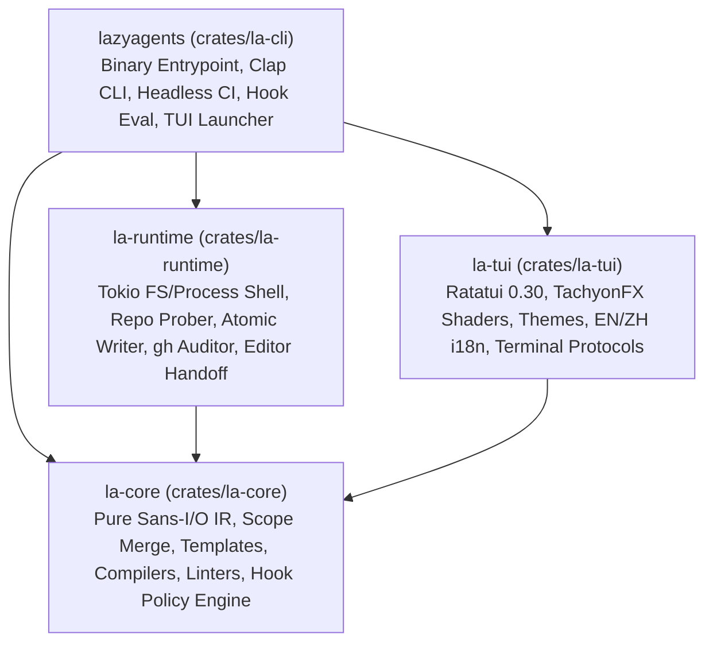

# Rust Engineering Standards (`lazyaix/lazyagents`)

This document is the authoritative Rust engineering specification for **`lazyaix/lazyagents`**. It defines our toolchain baseline, four-layer Cargo workspace architecture, ultra-strict compiler/Clippy governance, module & `.rs` file organization, pure native Rust design principles (incorporating the [Official Rust API Guidelines](https://rust-lang.github.io/api-guidelines/) and [Microsoft Pragmatic Rust Guidelines (`M-*`)](https://microsoft.github.io/rust-guidelines/)), error handling, structured Tokio concurrency, observability, supply-chain hygiene, and verification pyramid.

For product positioning and domain architecture, see [docs/architecture.md](architecture.md). For TUI visual aesthetics, shader pipelines, terminal protocols, and rendering architecture, see [docs/tui-architecture.md](tui-architecture.md). For GitHub workflow, branching, and release governance, see [docs/git-workflow.md](git-workflow.md).

---

## 1. Product Positioning & Four-Layer Clean Workspace

`lazyagents` is **Binary-first with an internal modular Cargo Workspace**: we optimize first for an extraordinary **Multi-Agent Project Configuration Studio, Engineering Governance Compiler, and Hook Policy Engine** (TUI + headless CI CLI) while organizing internal crates along clean, library-grade boundaries so stable sub-crates can be published to `crates.io` in the future without architectural rewrites.

### 1.1 Crate Topology & Strict Unidirectional Dependencies



| Crate | Path | Responsibility | Allowed Internal Dependencies |
| :--- | :--- | :--- | :--- |
| **`la-core`** | `crates/la-core` | Pure **Sans-I/O** (`M-IMPL-IO`) canonical manifest & engineering IR, scope resolver, `minijinja` template engine, target compilers, budget & compliance linters, `hook_eval` policy engine, lock/diff planner, secret redaction | **None** (zero network, filesystem, PTY, Tokio, or Ratatui dependencies) |
| **`la-runtime`** | `crates/la-runtime` | Tokio async & filesystem orchestration: workspace discovery, offline repo/Git/`.github` prober, importer, atomic whole-file & managed-block writer, local pack loader, read-only `gh` CLI auditor, `$VISUAL`/`$EDITOR` handoff | `la-core` only |
| **`la-tui`** | `crates/la-tui` | Ratatui 0.30 Config Studio rendering, `TachyonFX` shader pipeline, semantic theme engine, `en`/`zh` i18n, Markdown/syntax-highlighted previews & diffs, dual-mode body editor, terminal protocols | `la-core` only |
| **`lazyagents`** | `crates/la-cli` | Executable binary (`lazyagents`), `clap` argument parsing, headless CI & `hook eval`/`github audit` commands, `color-eyre` & `tracing` setup, signal handling, wiring `la-runtime` ↔ `la-tui` | `la-core`, `la-runtime`, `la-tui` |

**Hard Architectural Rules**:
- **`la-tui` MUST NEVER depend on `la-runtime`** (and vice versa). All communication crosses typed events/commands defined in `la-core`. This guarantees `la-tui` compiles rapidly and runs deterministic `TestBackend` snapshot tests with zero filesystem or subprocess side effects, while `la-runtime` powers headless CI and `hook eval` modes with zero TUI dependencies.
- **Workspace Root Manifest**: Uses `resolver = "3"` (MSRV-aware Rust 2024 resolver) and centralizes metadata (`[workspace.package]`), versions (`[workspace.dependencies]`), and lints (`[workspace.lints]`). Every member crate inherits them via `*.workspace = true`.

---

## 2. Toolchain, Edition & Modern Rust 1.100 Adoption

| Dimension | Standard |
| :--- | :--- |
| **Rust Edition** | `2024` |
| **MSRV (`rust-version`)** | `1.100` (pinned in `[workspace.package]`) |
| **Toolchain Pinning** | `rust-toolchain.toml` pinned to `1.100.0` (`profile = "minimal"`, components `clippy`, `rustfmt`) |
| **Upgrade Cadence** | Controlled periodic bumps via dedicated PRs — eliminates surprise Clippy regressions on unrelated feature PRs |

### Idiomatic Rust 1.85–1.100 Features Expected in This Codebase

Prefer native modern Rust capabilities over legacy boilerplate or micro-crates:

- **Never Type (`!`, 1.100)**: Use `!` for diverging computations and infallible `Result<T, !>` paths (`core::convert::Infallible` is now an alias for `!`).
- **`DropGuard` (1.100)**: Use standard RAII drop guards for zero-boilerplate cleanup (terminal mode restoration, PTY teardown, temporary worktree cleanup).
- **`assert_matches!` / `debug_assert_matches!` (1.96)**: Use standard-library pattern assertions in tests instead of manual `match` boilerplate.
- **Copy-friendly `core::range` (1.96)**: Prefer `Copy` range types when modeling text spans, selections, and line intervals.
- **`cfg_select!` & `if let` Match Guards (1.95)**: Use `cfg_select!` instead of adding the `cfg-if` crate; use `if let` match guards to flatten nested branch logic.
- **`slice::array_windows` (1.94)**: Prefer fixed-size typed windows over manual slice indexing.
- **Let Chains (1.88)**: Flatten nested `if let` blocks with `if let Some(a) = x && let Ok(b) = y && cond`.
- **`std::io::pipe` (1.87)**: Use standard anonymous pipes for subprocess IPC where PTY is not required.
- **Trait Upcasting (1.86)**: Rely on native `&dyn SubTrait` → `&dyn SuperTrait` / `Arc<dyn SubTrait>` → `Arc<dyn SuperTrait>` coercion instead of hand-written `as_base()` methods.
- **Rust 2024 Edition (1.85)**: Leverage `use<..>` RPIT precise lifetime capturing, fixed `if let` temporary drop order, and `async |..|` closures.
- **Native Cargo 1.97–1.100 Tooling**: Use `CARGO_BUILD_WARNINGS=deny` in CI instead of global `RUSTFLAGS=-D warnings` (preserving build caches), `.cargo/config.toml` `global-min-publish-age = "7 days"`, and Cargo's native unused-dependency checks (`[workspace.lints.cargo]`).

---

## 3. Ultra-Strict Compiler, Clippy & Formatting Baseline

All lints are governed centrally in the root `Cargo.toml` under `[workspace.lints]` and inherited by every crate via `[lints] workspace = true`.

### 3.1 Compiler (`rustc`) Lints
- `unsafe_code = "forbid"` — Safe Rust only across our entire workspace (OS/FFI unsafe remains encapsulated inside vetted upstream crates such as `crossterm` and `portable-pty`).
- `unsafe_op_in_unsafe_fn = "deny"`
- `missing_docs = "warn"` — Every public crate, module, type, trait, variant, field, and function MUST carry concise, accurate Rustdoc.
- `missing_debug_implementations = "warn"` (`M-PUBLIC-DEBUG`) — Every public type MUST implement `Debug` (using custom redacted `Debug` for secrets).
- `rust_2018_idioms = "warn"`, `unreachable_pub = "warn"`, `unused_qualifications = "warn"`.

### 3.2 Clippy Ultra-Strict Tier
- **Enabled Groups**: `clippy::all`, `clippy::pedantic` (includes `wildcard_imports` and `enum_glob_use`), and `clippy::nursery` (safe and reproducible because `rust-toolchain.toml` pins the exact toolchain version).
- **TUI & Agent Production Red Lines (`deny`)**:
  - `unwrap_used`, `expect_used`, `panic`, `unimplemented`, `exit` — Production code MUST NEVER panic or abruptly exit without restoring terminal state via RAII/cleanup.
  - `print_stdout`, `print_stderr`, `dbg_macro` — **Critical TUI invariant**: stray writes to stdout/stderr corrupt the active terminal screen buffer. CLI output MUST write explicitly to an injected/owned `std::io::Write` sink (or `tracing` file/buffer sink).
  - `await_holding_lock` — Never hold a synchronous mutex/rwlock guard across `.await`.
- **Module, Arithmetic, Indexing & Lint-Override Hygiene (`warn`, enforced as errors in CI)**:
  - `mod_module_files` — Mechanically bans `mod.rs` across the entire workspace in favor of modern `foo.rs` + `foo/` layout.
  - `arithmetic_side_effects`, `indexing_slicing`, `cast_lossless`, `cast_possible_truncation`, `cast_possible_wrap`, `cast_precision_loss`, `cast_sign_loss` — Use checked/saturating arithmetic, `.get(...)`, `try_from(...)`, or documented invariants.
  - `allow_attributes` and `allow_attributes_without_reason` (`M-LINT-OVERRIDE-EXPECT`) — **NEVER use `#[allow(...)]`**. Always use `#[expect(clippy::..., reason = "...")]` so stale suppressions fail CI automatically once the underlying code changes.
- **Test Ergonomics (`clippy.toml`)**: `allow-unwrap-in-tests`, `allow-expect-in-tests`, `allow-panic-in-tests`, `allow-dbg-in-tests`, `allow-print-in-tests`, and `allow-indexing-slicing-in-tests` are enabled so tests remain concise while production code stays ironclad.

### 3.3 Formatting (`rustfmt.toml`)
- Strictly uses **stable `rustfmt` options only** (`edition = "2024"`, `style_edition = "2024"`, `max_width = 100`, `newline_style = "Unix"`, `use_field_init_shorthand = true`, `use_try_shorthand = true`, `reorder_imports = true`, `reorder_modules = true`).
- Never introduce nightly-only `rustfmt.toml` options while pinned to stable `1.100.0`.

---

## 4. Module Organization, `.rs` Splitting & `lib.rs` Boundaries

### 4.1 Modern File-Tree Style (Zero `mod.rs`)
- **Enforced by `clippy::mod_module_files = "warn"`**: Never create `foo/mod.rs`. Always declare parent modules as `foo.rs` paired with a sibling `foo/` directory when child submodules exist:
  ```text
  src/
  ├── lib.rs
  ├── composer.rs          # Declares `mod keymap; mod state;`, re-exports or exposes public items
  └── composer/
      ├── keymap.rs
      └── state.rs
  ```
- **Avoid `clippy::module_inception`**: Never place `foo/foo.rs` inside `foo/`. Keep the primary concept in `foo.rs` and name child files by distinct sub-responsibilities (`state.rs`, `render.rs`, `parser.rs`).
- **Shallow Depth**: Keep module nesting within a single crate to **≤ 3 levels**. Larger architectural boundaries belong at the Cargo workspace crate level (`la-core`, `la-runtime`, `la-tui`, `la-cli`), not inside 5-deep directory trees.

### 4.2 `lib.rs` Strict Facade + Hybrid Namespace & Thin `main.rs`
Every library crate's `src/lib.rs` is a **Strict Facade** that decouples external ergonomics from internal file layout:

- **Allowed in `lib.rs`**:
  1. `//!` crate-level overview documentation, architectural invariants, and high-level doctest examples.
  2. Internal module declarations (`mod ...;`) and intentional subsystem namespaces (`pub mod ...;`).
  3. Curated, explicit `pub use` re-exports of high-frequency core types (never `pub use foo::*;` and never `prelude::*` per `M-NO-PRELUDE`).
  4. At most minimal crate-root entry wiring or a root error alias when strictly appropriate.
- **Forbidden in `lib.rs`**: Domain `struct`/`enum` definitions, state machines, business logic implementations, helper functions, and unit test blocks.
- **Hybrid Namespace Strategy**:
  - Flatten high-frequency core types to the crate root via explicit `pub use` (e.g., `la_core::{AgentId, RedactedSecret, SessionStatus}`).
  - Keep cohesive multi-type subsystems under clear `pub mod` namespaces (e.g., `la_tui::theme`, `la_tui::widgets`, `la_tui::protocol`) so the crate root never becomes crowded or ambiguous.
- **Thin `main.rs` Shell**: `crates/la-cli/src/main.rs` MUST remain a thin entrypoint (< 100 LOC) that sets up panic/error hooks, parses CLI arguments, initializes `tracing`, delegates to internal modules (`startup.rs`, `commands/`), and exits cleanly.

### 4.3 `.rs` File Splitting Criteria (Domain Cohesion + Soft Thresholds)
- **Slice Vertically by Domain Concept**: Organize files by cohesive domain responsibilities (`agent.rs`, `secret.rs`, `session.rs`, `theme/palette.rs`).
- **Ban Syntax-Bucket & Trashcan Files**: Never create `structs.rs`, `enums.rs`, `traits.rs`, `types.rs`, `utils.rs`, `helpers.rs`, or `common.rs` in production code. *(A dedicated `error.rs` for a crate's canonical error enum is a well-defined responsibility and is allowed.)*
- **Mandatory Split Triggers**:
  1. **Invariant Encapsulation**: In Rust, **the privacy boundary is the module, not the `struct`**. Whenever a type owns strict internal invariants (e.g., `RedactedSecret`, `AgentId`, ring buffers) that sibling code must not bypass, place it in its own module so private fields are compiler-enforced.
  2. **Independent Change Axes**: Split when a file houses unrelated domain concepts that evolve for different reasons.
  3. **Platform / Feature Isolation**: Isolate `#[cfg(unix)]`, `#[cfg(windows)]`, or optional Cargo feature implementations in dedicated submodules.
- **Soft Size Guidelines (Heuristics, Not Rigid Law)**:
  - **50–300 LOC**: Sweet spot — one primary concept plus its tightly coupled supporting enums/errors, `impl` blocks, and unit tests.
  - **> 500 LOC**: Evaluate whether natural sub-responsibilities or oversized unit tests (> 300 LOC) should be extracted.
  - **> 800 LOC**: Split by default unless the file is a single tightly cohesive state transition table or protocol decoder with documented rationale.
- **Anti-Over-Fragmentation**: Never artificially split one 40-line `struct` and two tiny helper `enum`s into three files ("one class per file"). Preserving locality of behavior beats artificial micro-files.

### 4.4 In-File Reading Order (BLUF), Imports & Least Visibility
- **BLUF (Bottom Line Up Front) Ordering** inside every `.rs` file:
  1. `//!` module documentation
  2. `mod` child module declarations
  3. `use` imports grouped by origin: `core`/`std` → external crates → `crate::` → `super::`/`self::`
  4. Public constants, type aliases, and core data/trait definitions (`struct`, `enum`, `trait`) — types before behavior
  5. `impl` blocks: inherent `impl Type` → workspace/project traits → standard library traits (`Default`, `Display`, `From`, etc.)
  6. Private helper functions and private internal types
  7. `#[cfg(test)] mod tests`
- **Import Path Discipline**:
  - Use `use crate::...` for cross-module imports (immune to moving the current file).
  - Use `use super::...` only for tightly coupled parent/child submodules and `mod tests`.
  - **Never** write `super::super::...` multi-level relative climbs.
  - **Never** use wildcard imports (`use foo::*;`) in production code (enforced by `clippy::wildcard_imports`; `use super::*;` inside `#[cfg(test)]` is permitted).
- **Least Visibility Ladder**: Default to **private** → widen only as far as strictly required: `private` → `pub(super)` (parent & sibling submodules) → `pub(crate)` (crate-internal sharing) → `pub` (audited external API contract). Keep struct fields private whenever invariants exist; enforced alongside `unreachable_pub = "warn"`.

---

## 5. Native Rust Design Principles & Idioms (`M-*`)

We follow **100% pure native Rust engineering principles** rooted in ownership, algebraic data types, traits, and the [Microsoft Pragmatic Rust Guidelines (`M-*`)](https://microsoft.github.io/rust-guidelines/), without importing OOP inheritance mental models:

1. **High Cohesion & Single Reason to Change**: Keep each module and struct focused on a single cohesive domain axis. Never build "God structs" that mix I/O handles, domain state, and rendering buffers. Rely on module privacy to guard invariants.
2. **Parse, Don't Validate**: Convert raw external inputs (CLI flags, TOML configs, environment variables, JSON/LLM payloads) into validated strong types (`AgentId`, `NonZeroU16`, `RedactedSecret`) at system boundaries. Downstream code consumes proof-carrying types with zero redundant checks or `.unwrap()`.
3. **Make Illegal States Unrepresentable**: Replace coupled `bool` / `Option` field combinations with Algebraic Data Types (`enum`) and **TypeState** generics (e.g., `AgentSession<Idle>` → `AgentSession<Running>` → `AgentSession<AwaitingApproval>`). Let exhaustive `match` turn missing cases into compile errors.
4. **Functional Core, Imperative Shell / Sans-I/O (`M-IMPL-IO`)**: Place deterministic state machines, parsers, diff/layout math, and secret redaction in pure functions and `la-core`; push async I/O, PTYs, clocks, and terminal flushing to outer shells (`la-runtime`, `la-tui`, `la-cli`).
5. **Progressive Abstraction (`M-DI-HIERARCHY`) & Small Orthogonal Traits**:
   - Escalate strictly along: **Concrete Types → Closed `enum` / Static Generics (`impl Trait`) + Native AFIT → Boundary `dyn Trait`**.
   - **Never create single-implementation traits** just for ceremony. Introduce traits only at genuine polymorphism or I/O-isolation boundaries (LLM providers, tool registries, TUI components/backends).
   - Keep traits small, focused, and composable via multi-bounds (`T: A + B`). At async `dyn` boundaries, use explicit `Pin<Box<dyn Future<Output = ...> + Send + '_>>` (or `dynosaur` companion adapters) and leverage Rust 1.86 **Trait Upcasting**.
6. **Rule of Three (WET → DRY), YAGNI & KISS**: Because Rust's static types and lifetimes make wrong abstractions costly to unwind, tolerate modest duplication once or twice and extract shared abstractions on the **third** concrete occurrence when the true shape is clear. Never build speculative multi-layer generics before a concrete caller needs them.
7. **Ownership- & Borrowing-Driven CQS & Encapsulation**:
   - Honor Command-Query Separation naturally through Rust receivers: pure queries take `&self`; state-mutating commands take `&mut self` or consume `self`.
   - Attach state-transition behavior directly onto the owning type (`session.approve(id)`) rather than exposing raw mutable internals for external mutation.
   - Avoid deep `a.b().c().mutate()` traversal chains and cyclic `Rc<RefCell<T>>` graphs; prefer flat arenas (`Vec` / slot maps) with typed IDs and unidirectional DAG data flow.
8. **Zero-Copy & Low-Friction Pragmatics**:
   - Share immutable streaming data with `Arc<str>`, `Cow<'_, str>`, or `bytes::Bytes` instead of indiscriminate `.clone()`.
   - Provide builders for complex multi-option configs (`M-INIT-BUILDER`).
   - Prefer `macro_rules!` over custom `proc-macro` crates (`M-EXAMPLE-OVER-PROC`).
   - Never leak third-party types across public boundaries (`M-DONT-LEAK-TYPES`); implement `Display` for human-facing types (`M-PUBLIC-DISPLAY`); document non-obvious constants (`M-DOCUMENTED-MAGIC`).

---

## 6. Error Handling & Diagnostics

| Layer | Crate / Strategy | Rules |
| :--- | :--- | :--- |
| **`la-core` / `la-runtime` / `la-tui`** | **`thiserror` 2.0** | Define canonical, strongly-typed structured error enums (`M-ERRORS-CANONICAL-STRUCTS`). Never use `String` as an error type. Implement `From` conversions cleanly (`M-FROM-ERROR`) without leaking third-party error types across public boundaries (`M-DONT-LEAK-TYPES`). Use `!` for infallible operations. |
| **`lazyagents` (`crates/la-cli`)** | **`color-eyre`** | Top-level application error reporting with contextual `.wrap_err(...)`, `tracing` SpanTrace integration, and a **terminal-restoring panic hook** installed before entering raw mode/alternate screen so panics always restore the user's terminal before rendering diagnostics. |

---

## 7. Async Runtime & Structured Concurrency (Tokio)

- **Structured Concurrency Only**: Every background task MUST be tracked by a `tokio_util::task::TaskTracker` or `tokio::task::JoinSet` and wired to a shared hierarchical `CancellationToken`. Detached fire-and-forget `tokio::spawn` tasks are prohibited.
- **Bounded Channels & Explicit Backpressure**: Prefer bounded `tokio::sync::mpsc`, `watch`, or `broadcast` channels over unbounded queues. Document overflow behavior (coalesce tokens, drop stale telemetry ticks, or apply backpressure).
- **Cancellation Safety**: Any future polled inside `tokio::select!` MUST be cancellation-safe (or explicitly guarded/pinned outside the loop).
- **No Blocking on Async Workers**: Offload CPU-intensive tasks (`syntect` highlighting of large files, diff generation, image decoding/resizing for `ratatui-image`, large directory walks) to `tokio::task::spawn_blocking` so both async I/O and the 60 FPS TUI render loop stay completely stutter-free.
- **No Sync Locks Across `.await`**: Enforced automatically by `clippy::await_holding_lock = "deny"`.

---

## 8. Observability & Secret Hygiene

- **Structured `tracing` (`M-LOG-STRUCTURED`)**: Use structured key-value fields (`tracing::info!(session_id = %id, tokens = count, "turn completed")`) and `#[instrument(skip(...))]` (always skipping secrets, prompts containing sensitive data, and large payloads).
- **Zero Stdout/Stderr Pollution in TUI Mode**: When the TUI is active, `tracing` MUST write exclusively to:
  1. A rotating file appender (`tracing-appender`, e.g., under platform XDG/state cache directory), and
  2. An in-memory bounded ring buffer viewable in an in-TUI live diagnostics drawer.
- **Secret Redaction & GitHub Token Safety**:
  - Store all tokens/API keys in dedicated redacted newtypes (`RedactedSecret`) as **variable-length opaque strings** (never cap lengths at 40 or 255 characters, and never decode JWT payloads).
  - Never emit raw secrets in `Debug`, `Display`, `Serialize`, error messages, logs, or LLM context.
  - Redaction regexes MUST cover modern ~520-character stateless GitHub App installation tokens (`ghs_[A-Za-z0-9._-]{36,}`), GitHub PATs (`ghp_`, `gho_`, `ghu_`, `github_pat_`), and LLM provider API keys.
  - Never send the retired `X-GitHub-Stateless-S2S-Token` header.

---

## 9. Dependency & Supply-Chain Governance

- **Zero-Copyleft Permissive License Allowlist (`deny.toml`)**:
  - Allowed licenses: `0BSD`, `Apache-2.0`, `Apache-2.0 WITH LLVM-exception`, `BSD-2-Clause`, `BSD-3-Clause`, `BSL-1.0`, `CC0-1.0`, `CDLA-Permissive-2.0`, `ISC`, `MIT`, `Unicode-3.0`, `Zlib`.
  - **MPL, LGPL, GPL, and AGPL are explicitly rejected**. Choose pure permissive alternatives (for example, MIT/Apache fuzzy matching instead of MPL-2.0 crates).
- **Dual-Layer Publish Cooldown**:
  - Cargo layer (`.cargo/config.toml`, Rust 1.100): `global-min-publish-age = "7 days"` blocks automatic resolution of freshly published crates during local/CI updates. Emergency security patches can be explicitly opted in per command via `CARGO_RESOLVER_INCOMPATIBLE_PUBLISH_AGE=allow cargo update -p <crate> --precise <ver>`.
  - Automation layer (`.github/dependabot.yml`): 7-day Dependabot cooldown for both `cargo` and `github-actions`.
- **Zero Unused or Wildcard Dependencies**:
  - `wildcards = "deny"` and `unknown-git = "deny"` in `deny.toml`.
  - Rust 1.100 native unused-dependency checks enabled via `[workspace.lints.cargo]` (`unused_dependencies = "warn"`).
- **Pure-Rust First**: Prefer pure-Rust crates without C/C++ compiler requirements (e.g., `syntect` with `default-features = false, features = ["default-fancy"]` instead of C `onig`, `rustls` over OpenSSL) to keep macOS, Linux `musl`, and Windows builds frictionless.

---

## 10. Test File Organization & Ultimate Quality Gate Pyramid

### 10.1 Test File Layout
- **Unit Tests (White-Box)**: Place inside `#[cfg(test)] mod tests` at the bottom of the module under test so private invariants can be exercised directly. Once a module's unit tests exceed **~300 LOC**, extract them into a sibling submodule file `foo/tests.rs` declared via `#[cfg(test)] mod tests;` inside `foo.rs` (preserving private visibility without cluttering production code).
- **Integration Tests (Black-Box)**: Use the **single-binary integration test layout** per crate (avoiding N-times linking overhead across `tests/*.rs` and keeping zero `mod.rs` files):
  ```text
  crates/la-core/
  └── tests/
      └── integration/
          ├── main.rs        # Single integration test binary entrypoint
          ├── common.rs      # Shared fixtures & helpers
          ├── session.rs     # Feature-scoped black-box test suite
          └── redaction.rs
  ```

### 10.2 Six-Layer Verification Pyramid
1. **Formatting & Static Analysis**: `cargo fmt --all -- --check` and `cargo clippy --workspace --all-targets --all-features -- -D warnings` with `CARGO_BUILD_WARNINGS=deny`.
2. **Documentation Integrity**: `RUSTDOCFLAGS="-D warnings" cargo doc --workspace --no-deps --all-features` (zero broken intra-doc links, zero missing public docs) plus doctests (`cargo test --workspace --doc --all-features`).
3. **Unit & Integration Tests (`cargo-nextest`)**: Fast isolated test execution using Rust 1.96 `assert_matches!` and Sans-I/O state-machine tests in `la-core`.
4. **TUI Visual & Layout Snapshots (`TestBackend` + `insta`)**: Deterministic buffer snapshots across multiple terminal dimensions (`80×24`, `120×40`, `180×50`), CJK/Emoji wide-character strings, `NO_COLOR`, and ASCII fallback modes.
5. **Property-Based Tests (`proptest`)**: Fuzz/invariant tests for streaming Markdown parsers, Unicode wrapping/truncation, secret redactors, and core state-machine transitions.
6. **Cross-Platform, Coverage & Mutation Gates**:
   - **Cross-Platform CI**: `ubuntu-latest` (required `Test` gate) + `macos-latest` and `windows-latest` (`Cross-Platform` matrix) to verify terminal protocols, paths, and PTY behavior everywhere.
   - **Code Coverage**: `cargo-llvm-cov` tracked in CI.
   - **Mutation Testing**: `cargo-mutants` targeting `la-core` state machines and redaction/protocol invariants (run on `main`, weekly schedule, and manual dispatch to catch subtle logic gaps without slowing feature PRs).

### Mandatory Local Verification Command Set

Before pushing or updating any PR:

```bash
cargo fmt --all -- --check
CARGO_BUILD_WARNINGS=deny cargo clippy --workspace --all-targets --all-features -- -D warnings
cargo test --workspace --all-features
RUSTDOCFLAGS="-D warnings" cargo doc --workspace --no-deps --all-features
```
