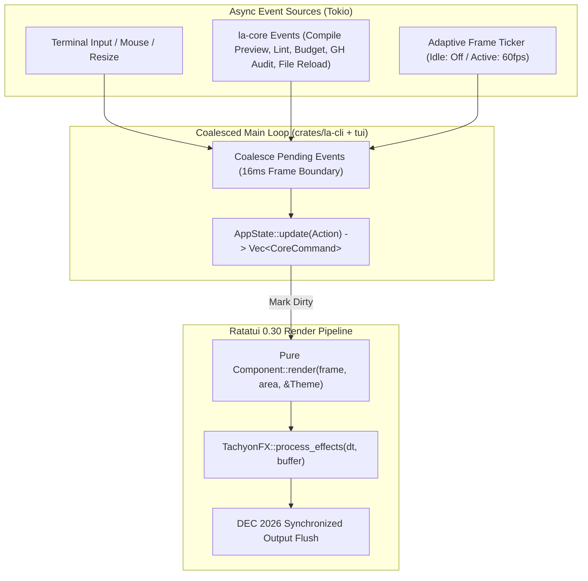

# TUI Architecture & Visual Engineering Specification (`lazyaix/lazyagents`)

This document defines the architecture, **L4 Cyber Flagship** visual/motion pipeline, pure-Rust widget boundaries, modern terminal protocol stack, performance budgets, and testing discipline for **`la-tui`**—the interactive **Multi-Agent Project Configuration Studio** of `lazyagents`.

For product positioning, Hybrid SSOT, and compiler architecture, see [docs/architecture.md](architecture.md). For general Rust language, Workspace, Clippy, concurrency, and testing standards, see [docs/rust-standards.md](rust-standards.md).

---

## 1. UX Paradigm: Dual-Mode Config Studio & Headless CLI

`lazyagents` delivers a **dual-mode terminal experience** powered by a single `la-core` canonical IR, compiler, and linter engine:

| Mode | Trigger | Viewport | Primary Use Case |
| :--- | :--- | :--- | :--- |
| **Fullscreen Config Studio (Default in TTY)** | `lazyagents` | `Viewport::Fullscreen` (Alternate Screen) | Project overview dashboard, 24 KB / 20k-token budget radar, Engineering Governance & GitHub Audit views, 8 Antigravity resource editors, live compiled preview & diff split, floating shadowed modals, `Ctrl+K` command palette, `en`/`zh` i18n, full L4 `TachyonFX` shaders |
| **Inline Quick View (Optional)** | `lazyagents --inline` | `Viewport::Inline(height)` | Compact diagnostic/diff inspection preserving native terminal scrollback |
| **Headless / CI CLI Mode** | Any subcommand (`check`, `generate`, `hook eval`, `github audit`, …) / `--no-tui` / non-TTY stdout | None (`la-tui` never initialized) | CI/CD merge gates, `lazyagents hook eval` stdin/stdout policy execution, scripts, and AI-agent automation |

**Architectural Consequence**: Because `la-tui` depends strictly on `la-core` (and never on `la-runtime`), both interactive TUI previews and headless CI `check`/`generate` runs execute the exact same compilation, budget calculation, secret scanning, and diff planning logic.

---

## 2. Core TUI Stack & Pure-Rust Component Boundaries

All selected crates MUST pass `deny.toml`'s zero-Copyleft permissive license policy (MIT / Apache-2.0 / BSD / ISC / Zlib / CC0 / 0BSD / BSL-1.0 — **no MPL/GPL**).

### 2.1 Rendering Core & Backend Isolation
- **Rendering Engine**: **Ratatui 0.30.x** (`ratatui-core` + `ratatui-widgets` + `ratatui`). Internal widget sub-modules target `ratatui-core` primitives for maximum API stability and minimal compile cost.
- **Terminal Backend**: **`ratatui-crossterm`** (Linux, macOS, Windows), wrapped behind a thin internal `TerminalBackendAdapter` in `la-tui` so future adoption of `ratatui-termina` (Helix VT engine) or custom test backends requires zero widget changes.

### 2.2 Pure-Rust First Heavy Components
- **Live Compiled Preview & Syntax Highlighting (100% Pure Rust)**:
  - Markdown preview: **`pulldown-cmark`** with block-level caching for compiled `AGENTS.md`, conditional rules, `SKILL.md`, and subagent prompts.
  - Syntax highlighting: **`syntect`** configured strictly with **`default-features = false, features = ["default-fancy"]`** (using the pure-Rust `fancy-regex` engine instead of the C `onig` library) for TOML, JSON (`hooks.json`, `mcp_config.json`, `plugin.json`), YAML (`.github/workflows/*.yml`), and Markdown, guaranteeing zero C-toolchain friction for `musl` static builds and cross-compilation.
- **Rich Diff Viewer**: **`similar`** for unified and side-by-side diffs of whole-file outputs and managed fenced blocks (`CODEOWNERS`, `.gitignore`), with inline word-level change highlights.
- **Dual-Mode Editing & `$VISUAL`/`$EDITOR` Handoff**:
  - Typed structured forms for manifest fields (dropdowns, capability checklists, secret `${VAR}` builders, section reordering).
  - Lightweight built-in multiline editor for quick body tweaks (`Enter` / `Shift+Enter` via Kitty Keyboard Protocol, fallback `Alt+Enter`/`Ctrl+J`) plus optional Vim navigation bindings.
  - Seamless external editor handoff (`e` key): cleanly restores terminal state via `DropGuard`, spawns `$VISUAL`/`$EDITOR` on the source file in `la-runtime`, and resumes the TUI with immediate re-lint, budget recalculation, and live diff refresh.
- **Built-in `en` / `zh` Localization**: Complete bilingual UI string catalog (English default, `--lang en|zh`, locale auto-detection, live in-TUI toggle) with zero hardcoded display labels inside widgets.
- **Unicode & CJK Layout Precision**: Every width calculation, cursor jump, and line wrap MUST operate on grapheme clusters (`unicode-segmentation`) and terminal cell widths (`unicode-width`) — never `.len()` or `.chars().count()` — ensuring pixel-perfect alignment for Chinese/Japanese/Korean text, Emoji, and Nerd Font glyphs.

---

## 3. L4 Cyber Flagship Visual & Motion Pipeline

`la-tui` treats terminal aesthetics as a first-class engineering discipline — combining dramatic visual polish with zero-compromise responsiveness and accessibility.

### 3.1 Post-Processing Shader Pipeline (`TachyonFX`)
Every frame renders standard Ratatui widgets first and then runs active stateful `TachyonFX` effects over the `Buffer`:
- **Ambient & Semantic Feedback**: Subtle HSL color breathing (`hsl_shift`) on active/thinking agent borders, smooth directional sweeps (`sweep_in`) on newly arrived tool/agent panels, dissolve/coalesce transitions (`dissolve` / `coalesce`) for status shifts.
- **Depth & Spatial Hierarchy**:
  - **Ratatui 0.30.1 `Block::shadow(...)`** on all floating modals, command palettes, and toast notifications.
  - **Modal Background Scrim**: When a floating modal opens, `TachyonFX` smoothly dims/desaturates the underlying screen buffer so focus pops immediately.
- **Curated Shader Presets**: Support named visual presets (e.g., *Cyber Glow*, *Aurora Sweep*, *Crisp Minimal*) configurable by the user.

### 3.2 High-Resolution Media & Animated Splash
- **Terminal Graphics (`ratatui-image`)**: Auto-probes terminal capabilities in priority order: **Kitty Graphics Protocol → iTerm2 Inline Images → Sixel → Unicode Halfblock (`▀▄`) fallback**. All image decoding, scaling, and protocol encoding MUST run off the render thread via `tokio::task::spawn_blocking`.
- **Animated Splash (`tui-big-text` + `TachyonFX`)**: Crisp animated startup banner/logo that completes rapidly (< 600ms), interrupts instantaneously on any keypress, and can be permanently disabled via `--no-splash` or user config.
- **Filled Telemetry Charts**: Use Ratatui 0.30.1 `GraphType::Area` filled charts and sparklines for live token throughput, latency, and multi-agent concurrency visualization.

### 3.3 Motion Accessibility & Remote SSH Discipline
Visual effects MUST NEVER trap users or degrade SSH sessions:
- Mandatory config & CLI toggle: `motion = "full" | "reduced" | "none"` (plus automatic detection of slow/dumb terminals or `TERM=dumb`).
- `reduced` replaces spatial dissolves/particles with instant subtle color transitions; `none` disables all frame-driven animations (strictly event-driven redraws only).

---

## 4. Semantic Design Token Theme Engine & Degradation Matrix

### 4.1 Zero Hardcoded Colors Rule
**Hardcoding `Color::Cyan`, `Color::White`, or raw `Color::Rgb(...)` inside widgets is strictly forbidden.** Every widget receives `&Theme` and queries semantic design tokens:

| Token Category | Required Semantic Tokens |
| :--- | :--- |
| **Surfaces** | `bg_canvas`, `bg_surface`, `bg_surface_elevated`, `bg_overlay_scrim`, `bg_selection` |
| **Borders & Depth** | `border_focused`, `border_muted`, `border_accent`, `shadow_color` |
| **Typography** | `text_primary`, `text_secondary`, `text_muted`, `text_inverse` |
| **Brand & Accents** | `accent_primary`, `accent_secondary`, `accent_glow` |
| **Agent Status** | `status_idle`, `status_thinking`, `status_running`, `status_approval`, `status_success`, `status_warn`, `status_error` |
| **Code & Diffs** | `diff_add_fg`, `diff_add_bg`, `diff_del_fg`, `diff_del_bg`, `diff_hunk`, `syntax_theme` |

### 4.2 Auto-Detection & Lossless Degradation
1. **Light/Dark Sensing (OSC 11)**: Probe terminal background luminance on startup (with safe short timeout so non-responding terminals never stall) to auto-select a matching dark or light built-in theme (e.g., Tokyo Night, Catppuccin Mocha/Latte, Cyber Neon) unless overridden in config.
2. **Color Profile Degradation**: `TrueColor (24-bit)` → `256-color (xterm)` → `ANSI-16` → **`NO_COLOR`** (honor the [`NO_COLOR`](https://no-color.org/) environment variable unconditionally; rely on weight/underline/borders for hierarchy when color is off).
3. **Glyph Set Degradation**: `Nerd Font` → `Pure Unicode` (Box Drawing + Braille + Geometric Shapes) → `Pure ASCII` (`+ - | > *`), selectable via config/flag and automatically fallen back when Unicode locale is unavailable.

---

## 5. Modern Terminal Protocol Suite

All advanced terminal protocols MUST negotiate cleanly at startup, degrade gracefully on legacy terminals (e.g., macOS Terminal.app, basic `tmux`, legacy Windows conhost), and restore original terminal state on exit:

| Protocol | Purpose in `lazyagents` | Fallback Strategy |
| :--- | :--- | :--- |
| **DEC Private Mode 2026 (Synchronized Output)** | Wraps every frame flush in `BSU` (`\x1b[?2026h`) / `ESU` (`\x1b[?2026l`) for **zero flicker / zero tearing** at 60 FPS | Ignored silently by terminals that don't support it |
| **Kitty Keyboard Protocol (CSI-u)** | Disambiguates `Shift+Enter` vs `Enter`, `Ctrl+I` vs `Tab`, `Esc`, and key-release events | Automatic probe; fallback to `Alt+Enter` / `Ctrl+J` for newline |
| **Bracketed Paste** | Pastes multi-line prompts/code cleanly without prematurely submitting | Standard input stream |
| **Focus Events (Gained / Lost)** | Automatically throttles or pauses ambient animations when terminal loses focus to save CPU/battery | Continuous adaptive tick |
| **OSC 8 (Hyperlinks)** | Clickable file paths, line references, PR links, and documentation URLs | Plain styled text |
| **OSC 52 (Clipboard)** | Copy code blocks/diffs reliably even over remote SSH and inside `tmux` | Local clipboard crate fallback when available |
| **OSC 9;4 (Progress Bar)** | Native taskbar/tab progress bar in Ghostty, Windows Terminal, ConEmu during long agent tasks | In-TUI status bar progress indicator |
| **OSC 9 / 777 (Notifications)** | Desktop alert when an autonomous agent completes or requires human approval | Terminal bell (optional) + in-TUI toast |

---

## 6. Unidirectional TEA Architecture & Performance Budgets

`la-tui` implements **The Elm Architecture (TEA)** combined with modular stateful components:

### Non-Negotiable Performance & Safety Rules
1. **Adaptive Frame Pacing**:
   - **Idle state** (no active `TachyonFX` shader, no running spinner): **0% CPU** — render ticker sleeps completely until an input or core event arrives.
   - **Active animation state**: Smooth **30–60 FPS** (`~16ms` budget per frame).
   - **Unfocused window**: Automatically drops ambient animation rate (e.g., to 2–5 FPS or paused).
2. **Frame Coalescing**: Drain all queued background compilation, highlight, and audit events before issuing a single frame draw per ~16ms tick. Never redraw redundantly on rapid bursts.
3. **Resize Debouncing & Layout Caching**: Cache rendered Markdown lines and highlighted spans keyed by `(content_hash, viewport_width, theme_id)` so scrolling is O(visible_lines) and terminal resizing stays smooth.
4. **Triple-Safety Terminal Restoration**:
   - **RAII `DropGuard` (Rust 1.100)** owned by the TUI session scope restores raw mode, Kitty keyboard flags, mouse capture, bracketed paste, focus events, cursor visibility, and alternate screen on every normal or early-return exit.
   - **Custom Panic Hook** chained with `color-eyre` restores terminal state *before* formatting any panic report.
   - **OS Signal Handler (`SIGINT` / `SIGTERM`)** triggers `CancellationToken` graceful shutdown so `DropGuard` runs deterministically.

---

## 7. Visual & Behavioral Testing Discipline

Every screen, modal, and custom widget in `la-tui` MUST be tested without a live TTY:

- **Multi-Resolution `TestBackend` + `insta` Snapshots**: Snapshot core layouts at minimum supported (`80×24`), standard (`120×40`), and ultrawide (`180×50`) sizes, asserting zero panics or clipped/broken borders even on tiny terminals (e.g., `20×8` graceful "terminal too small" notice).
- **CJK & Emoji Stress Tests**: Explicitly test Chinese/Japanese/Korean paragraphs, wide Emoji, and mixed Nerd Font icons inside wrapped Markdown, tables, and bordered blocks.
- **Degradation Snapshots**: Verify `NO_COLOR` and ASCII glyph modes produce crisp, readable layouts.
- **Deterministic Shader Step Tests**: Advance `TachyonFX` effects using fixed synthetic `Duration` steps on `TestBackend` rather than wall-clock `Instant::now()` so shader tests are 100% deterministic in CI.
